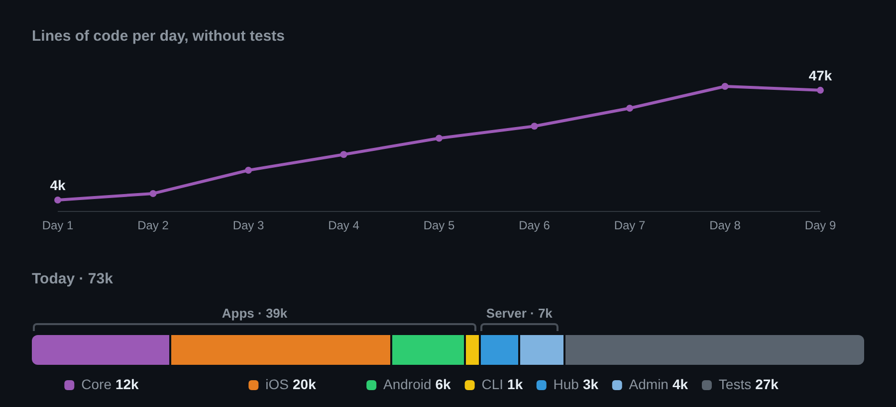

<p align="center">
  
</p>

<p align="center">The 2014 one-tap app is back.<br>
Tap a name to send an encrypted Yo, photo or video.</p>

<p align="center">
<a href="app/ios/README.md"><b>iOS</b></a> SwiftUI · <b>Android</b> Compose · <a href="app/yogpt"><b>CLI</b></a> Rust
</p>

<p align="center"><a href="https://justyo.co"><b>justyo.co</b></a></p>

<details>
<summary><h2>Core</h2></summary>

One Rust core runs the whole client. The apps only draw and pass HTTP and storage through.

- [core/client](core/client): identities, sessions, groups, media, recovery, outbox
- [core/wire](core/wire): protocol formats
- [core/bindings](core/bindings): Swift and Kotlin through UniFFI
- [app/ios](app/ios): Swift, the iPhone app and its extensions, on top of the core
- [app/android](https://github.com/YoAgain/yo/tree/android/app/android): Kotlin, on the `android` branch, same core
- [app/yogpt](app/yogpt): Rust, the CLI, uses the core directly

### Account Sync

What a new phone gets back besides the account, sealed and padded ([spec 6.9](spec/v1.md#69-storage)).
Not synced: sessions, messages, media, list order.

| Field | Example | Purpose |
|---|---|---|
| Friend name | `"n": "lina"` | shown in the list |
| Friend colour | `"c": 3` | the row's colour |
| Friend blocked | `"b": false` | a block survives a restore |
| Friend removed | `"r": false` | removed friends stay gone |
| Friends' profile keys | `"k": {"9e4b…": "HoILvR…LSo6gA"}` (43 chars) | sealed sender to them |
| Own profile key | `"pk": "Hm4L0R…LSo6gA"` (43 chars) | contacts write to you sealed |
| Group master key | `"k": "XmvfEe…Q0kJzg"` (43 chars) | read the group at the hub |
| Group joined | `"a": true` | member or request |
| Group left | `"r": false` | left groups stay gone |
| App icon | `"icon": "amethyst"` | the same icon |
| Left-handed | `"left_handed": true` | the same side |
| Version | `"version": 42` | old copies are ignored |

</details>

<details>
<summary><h2>Hub</h2></summary>

The relay between phones. It holds encrypted Yos until the recipient fetches them and cannot read them.

| | Yos/s | |
|---|---:|---|
| Hub alone | 10,431 | 1 CPU core · p50 2.1 ms · p99 130 ms |
| End to end | 3,826 | send, deliver, fetch, decrypt |
| Lost | 0 | |

Routes: [hub README](hub/README.md). Durability: [SECURITY.md](hub/SECURITY.md#durability). Load runs: [tests](tests/README.md#load).

</details>

<details>
<summary><h2>Encryption</h2></summary>

Only you and your friends can read a Yo. The hub passes it on sealed and sees only the recipient.

```text
Phone A ──Yo──► Hub ──push──► Phone B
Signal          sealed        fetches and
protocol        envelope      decrypts
```

- Signal protocol through libsignal: PQXDH, Double Ratchet, sealed sender
- Sign up with a name only, no phone number or email
- Account protected by iCloud Keychain, a passkey or a 64-character recovery key
- Groups up to 20 with zkgroup; photos and videos are view-once

Limits and details: [YoIP spec](spec/v1.md), [threat model](hub/SECURITY.md).

### Keys

Where each key lives on iOS, with made-up examples. iCloud: the synced Keychain item. Device: this phone's keychain.
DB: the local database, sealed per column.

| Key | Where | Example | Purpose |
|---|---|---|---|
| Account key | iCloud, DB | `1cd32765…32a9d1c8` (64 chars) | identity, the account |
| User id | iCloud, DB | `9e4b02bb46c6cf346d6a046281bf768e` | fixed id at the hub |
| Name | iCloud, DB | `Christopher` | to be found |
| Recovery key | iCloud, device | `598t 08e1 … s9ym 3qgy` (64 chars) | backup without iCloud |
| Backup status | iCloud | `{"byPasskey":true,"byCode":true,"version":3}` | same security after a restore |
| Ed25519 seed | iCloud | `d00b86d2…9034eaaa` (64 chars) | converted to today's key once |
| State key | device | `485ff0f2…76683972` (64 chars) | opens the local DB |
| Device key | DB | `e064d0db…8d30f026` (64 chars) | this device, encryption |
| Auth key | DB | `2cea6bee…c4bec8f3` (64 chars) | signs hub requests |
| Prekey | DB | `id 17 → 052a51fc…8ae42e84` (66 chars) | first message while offline |
| Profile key | DB | `1e820bbd…b4a8ea00` (64 chars) | sealed sender for contacts |
| Group key | DB | `5e6bdf11…0d242738` (64 chars) | read and change a group |
| Storage key | derived | `e55cab9c…d47e1e5d` (64 chars) | contacts at the hub |
| Session | DB | ratchet state, about 1–2 KB | a new key per message |
| Backup key K | RAM | never stored | encrypts the backup |
| Passkey | Apple Passwords | "Yo – Christopher" | backup by Face ID |

</details>

<details>
<summary><h2>Development</h2></summary>

<!-- loc -->

<!-- /loc -->

```sh
dev/cargo test --workspace     # tests, with Docker
dev/fuzz all 300               # fuzzing
```

[Tests](tests/README.md) · [chaos tests](tests/CHAOS.md) · [spec](spec/v1.md) · [AGENTS.md](AGENTS.md). Pull requests welcome.

</details>

<details>
<summary><h2>License</h2></summary>

Code: [MIT](LICENSE.md). The built app links libsignal and is [AGPL-3.0](LICENSES/AGPL-3.0.txt); its source is the commit
shown in Settings › Licenses. Name, logo and sound are not covered. [Third-party licenses](LICENSES).

</details>
