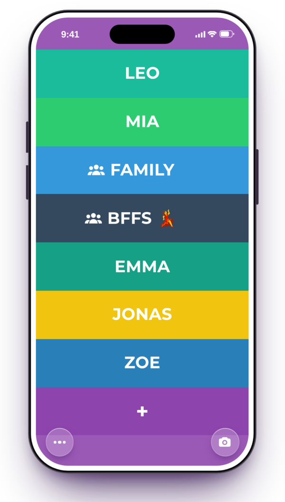

<p align="center">
  
</p>
<h1 align="center">Yo · It's that simple.</h1>

<p align="center">The 2014 one-tap app, back. Tap a friend's name or a group to send an end-to-end encrypted Yo.<br>
Send photos and videos to view once.</p>

<p align="center"><a href="https://justyo.co"><b>justyo.co</b></a> · <a href="https://testflight.apple.com/join/V3wa1DeX">TestFlight</a></p>

## How to use



1. **Pick a username.**
2. **Tap to send Yo.**

<br clear="right">

## Encryption

```text
  Phone A                          Hub                              Phone B
  ───────                          ───                              ───────
  encrypts with the Signal    ──►  stores a sealed envelope,   ──►  fetches it
  protocol (PQXDH + Double         sees only the recipient,         and decrypts
  Ratchet), hides the sender       sends a push with no content
```

Sign up with a name only. Your account is protected by Keychain sync, a passkey (PRF) or a 64-character recovery key.

<details>
<summary>Protocol, groups, media and privacy limits</summary>

[YoIP](spec/v1.md) uses Signal's libsignal: PQXDH and Double Ratchet with SPQR.
Contacts can verify a 60-digit safety number. Messages are padded; backups and account storage are encrypted.
[Recovery](spec/v1.md#7-backup-and-a-new-phone) uses passkey PRF or libsignal's 64-character recovery key.

Sealed sender hides the sender on deliveries to contacts, as shown above. First-contact requests are identified.
The hub sees recipients, lookups and traffic metadata; see the [privacy limits](spec/v1.md#1-goals)
and [threat model](hub/SECURITY.md). Only you and your recipients can read your Yos and media.

Groups use zkgroup, with up to 20 members; group names and membership are encrypted too.
Photos and videos are view-once: the app deletes them and their keys after viewing.
The server deletes the encrypted file after its last allowed fetch.

</details>

## Apps

- **iOS:** [SwiftUI, iOS 26, Swift 6](app/ios/README.md), available on [TestFlight](https://testflight.apple.com/join/V3wa1DeX).
- **Android:** Kotlin, Jetpack Compose and Material 3; in progress.
- **[YoGPT](app/yogpt):** a Rust client that answers Yos and can reply with pictures.

<details>
<summary>App details, Linux builds and shared core</summary>

The iOS app uses system navigation and controls, with Flat UI rows, Montserrat Bold and Amethyst (#9B59B6).
It includes camera capture, a share extension and notification replies.
Build on Linux with [xtool](https://github.com/xtool-org/xtool); install wirelessly with
`app/ios/dev/push.sh`. See the [build instructions](app/ios/README.md#build-and-run) and [device checks](app/ios/TESTING.md).

Android is being built on the [`android` branch](https://github.com/YoAgain/yo/tree/android), using the same core through UniFFI.

[core/client](core/client) handles identities, sessions, groups, media, recovery and the outbox in Rust.
[core/wire](core/wire) defines protocol formats. [core/bindings](core/bindings) exposes the client to Swift and Kotlin
through UniFFI; apps supply HTTP and storage.

</details>

## Hub

```text
hub alone    ████████████████████████████████  8,000 Yos/s   p50 7.7 ms · p99 ~20 ms
end to end   ██▊                                 700 Yos/s   send, deliver, fetch, decrypt
lost                                               0
```

<details>
<summary>Storage, durability and load tests</summary>

The small [Rust hub](hub/README.md) stores accounts, public prekeys, queued envelopes and encrypted files.
It has no message content keys. SQLite persists deliveries before acknowledging them using `synchronous = FULL`,
so an acknowledged Yo survives a power cut. Without the wait for disk, the hub does about 15,000 Yos/s.
Measured on one CPU core with the database on an SSD. See the [yo-load measurements and commands](tests/README.md#load).

</details>

## Development

<!-- loc -->
```text
2026-11-11    6,326  ████▍                             Rust 6.3k
2026-11-12    9,076  ██████▎                           Rust 7.4k · Swift 1.5k · Other 0.2k
2026-11-13   20,585  ██████████████                    Rust 13.4k · Swift 6.8k · Other 0.4k
2026-11-14   32,976  ██████████████████████▌           Rust 22.2k · Swift 10.0k · Other 0.8k
2026-11-15   46,740  ███████████████████████████████▉  Rust 33.6k · Swift 12.2k · Other 0.9k
2026-11-16   46,847  ████████████████████████████████  Rust 33.6k · Swift 12.2k · Other 1.1k
```
<!-- /loc -->

<details>
<summary>Tests, fuzzing, repository layout and contributing</summary>

The chart above counts lines of code on `main` per day, blanks, comments and tests included; `python3 -I dev/loc-chart.py` updates it.

[Tests](tests/README.md) cover real clients and the hub, groups, media, recovery, security and deterministic simulations.
[Chaos tests](tests/CHAOS.md) exercise faults, crashes and restarts; [fuzz targets](fuzz/fuzz_targets) cover parsers,
hub routes and the receive path. From the repository root, with Docker:

```sh
dev/cargo test --workspace
dev/cargo run --release -p yo-tests --bin yo-load -- --clients 200
dev/fuzz all 300
```

| Folder | Contents |
|---|---|
| [app/ios](app/ios) | iPhone app and build tools |
| [app/yogpt](app/yogpt) | YoGPT bot |
| [core](core) | Rust client, wire formats and bindings |
| [hub](hub) | Rust server |
| [spec](spec) | YoIP protocol |
| [tests](tests), [fuzz](fuzz) | Integration tests, load tools and fuzzing |
| [dev](dev) | Development scripts |

Issues and pull requests are welcome. Start with the [spec](spec/v1.md), follow [AGENTS.md](AGENTS.md),
and run the relevant [checks](tests/README.md). Keep secrets and machine settings out of the repository.

</details>

## License

<details>
<summary>MIT; the built app AGPL-3.0 (libsignal)</summary>

Yo's code is [MIT](LICENSE.md). The app and core link libsignal ([AGPL-3.0](LICENSES/AGPL-3.0.txt)),
so the built app as a whole is distributed under AGPL-3.0; corresponding source is in this repository at the
commit shown in Settings › Licenses. The hub does not link libsignal and is MIT.
The name, logo and sound are outside the code license. [Third-party license texts](LICENSES).

</details>
