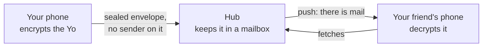

# Yo

**One tap, one Yo — end-to-end encrypted, and the server never learns who sent it.**

In 2014 Yo was an app that did one thing: you tap a friend's name, and their phone says "Yo". This is Yo again,
built on the protocol a modern messenger would use, so that even a message as small as a Yo stays between the two
of you.

## YoIP: Yo over IP

YoIP is how the apps and the server talk. It has three parts: **YoLS** keeps who you are and what you send secret,
the **hub** delivers, and the **content** says what a message is.



### YoLS: Yo Layer Security

Every chat is an MLS group (RFC 9420), the IETF standard for end-to-end encrypted chats. Only the phones in the chat
hold its keys, and the keys renew every week or every 100 messages: a key that leaks today stops being useful soon
after.

Who you are is a user id that never changes, with an account key that signs your devices, so a second device joins
your chats as you. Your phone number and username are only there so friends can find you, and any
contact can be checked against a 60-digit safety number, read out or compared on screen.

### Hub

The hub is a mailbox. A message reaches it addressed to a person but not signed by anyone (sealed sender), and
padded to one of four sizes, so a Yo looks like any other message. A push only wakes the phone and says "there is
mail"; the phone fetches and decrypts by itself, so Apple and Google never see who wrote.

| The hub knows | The hub never learns |
|---|---|
| phone numbers (as a keyed hash), devices, IP addresses | who sent a message |
| when messages arrive, and how big they are | what they say |
| who looked up whom | who chats with whom |

### Content

What a message says, once decrypted. A Yo is the smallest message there is: 13 bytes.

<details markdown="1">
<summary><b>Example</b> · a Yo, byte by byte</summary>

```
00 01                      version 1
00 00 01 A1 D3 EB AC 00    sent at 13 Nov 2026, 08:00 UTC (milliseconds)
00 01                      type 1: Yo
00                         body: empty
```

</details>

The full protocol: [spec/v1.md](spec/v1.md).

## Speed

The hub, pinned to one CPU core, under load from the others:

| | Yops | p99 |
|---|---|---|
| Database on an SSD | 16,000 | 19 ms |
| Database in RAM | 22,000 | 6 ms |

Yops are Yos delivered per second. One thread writes every delivery, one after the other, so that thread sets the
pace and more cores do not help; the disk costs about a third. All runs: [tests/README.md](tests/README.md#load).

## Layout

| | |
|---|---|
| [`core/wire`](core/wire) | the formats apps and hub agree on |
| [`core/mls`](core/mls) | the client core, in Rust, one for iOS and Android |
| [`core/bindings`](core/bindings) | that core for Swift and Kotlin, via UniFFI |
| [`hub/`](hub) | the server |
| [`tests/`](tests) | scenarios, simulation, robustness, fuzzing, load |
| [`app/ios/`](app/ios) | the iPhone app, a SwiftUI mockup for now |

## Run

```sh
dev/cargo test --workspace                                        # everything; needs only Docker
dev/cargo run --release -p yo-tests --bin yo-load -- --clients 200  # the load test
dev/fuzz all 300                                                  # every fuzz target for 5 minutes
```

## License

[O'Saasy](LICENSE.md): use, change and share freely, but not as a competing hosted service.
