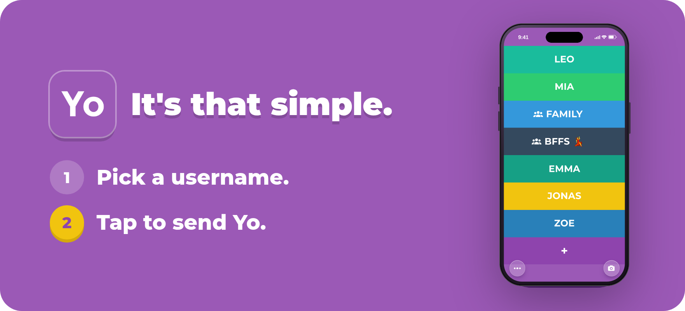

<p align="center">
  
</p>

<p align="center">The 2014 one-tap app, back. Tap a friend's name or a group to send an end-to-end encrypted Yo.<br>
Send photos and videos to view once.</p>

<p align="center"><a href="https://justyo.co"><b>justyo.co</b></a> · <a href="https://testflight.apple.com/join/V3wa1DeX">TestFlight</a></p>

## Apps

- **iOS:** [SwiftUI, iOS 26, Swift 6](app/ios/README.md), available on [TestFlight](https://testflight.apple.com/join/V3wa1DeX).
- **Android:** Kotlin, Jetpack Compose and Material 3; in progress.
- **[YoGPT](app/yogpt):** a Rust client that answers Yos and can reply with pictures.

<details>
<summary>App details, Linux builds and shared core</summary>

The iOS app uses system navigation and controls, with Flat UI rows, Montserrat Bold and Amethyst (#9B59B6).
It includes camera capture, a share extension and notification replies.
Build on Linux with [xtool](https://github.com/xtool-org/xtool); install wirelessly with
`app/ios/dev/push.sh`. See the [build instructions](app/ios/README.md#build-and-run) and [device checks](app/ios/TESTING.md).

Android is being built on the [`android` branch](https://github.com/YoAgain/yo/tree/android), using the same core through UniFFI.

[core/client](core/client) handles identities, sessions, groups, media, recovery and the outbox in Rust.
[core/wire](core/wire) defines protocol formats. [core/bindings](core/bindings) exposes the client to Swift and Kotlin
through UniFFI; apps supply HTTP and storage.

</details>

## Encryption

```text
┌──────────────────┐        ┌──────────────────┐        ┌──────────────────┐
│     Phone A      │        │       Hub        │        │     Phone B      │
│                  │        │                  │        │                  │
│ Signal protocol  │───Yo──►│ sealed envelope  │──push─►│ fetches and      │
│ PQXDH + Double   │        │ sees only the    │        │ decrypts         │
│ Ratchet, sender  │        │ recipient        │        │                  │
│ hidden           │        │ push: no content │        │                  │
└──────────────────┘        └──────────────────┘        └──────────────────┘
```

Sign up with a name only, no phone number or email. Your account is protected by Keychain sync, a passkey (PRF) or a 64-character recovery key. Details: the [YoIP spec](spec/v1.md).

<details>
<summary>Protocol, groups, media and privacy limits</summary>

[YoIP](spec/v1.md) uses Signal's libsignal: PQXDH and Double Ratchet with SPQR.
Contacts can verify a 60-digit safety number. Messages are padded; backups and account storage are encrypted.
[Recovery](spec/v1.md#7-backup-and-a-new-phone) uses passkey PRF or libsignal's 64-character recovery key.

Sealed sender hides the sender on deliveries to contacts, as shown above. First-contact requests are identified.
The hub sees recipients, lookups and traffic metadata; see the [privacy limits](spec/v1.md#1-goals)
and [threat model](hub/SECURITY.md). Only you and your recipients can read your Yos and media.

The optional Yo-to-Yo Roundtrip probe runs only when tapped. Its operator can see that the account was
active at that moment. No per-user probe history or timing is stored or logged (only aggregate counters;
mandatory encrypted protocol state and volatile rate limiting remain). Probes and their token-matched replies
stay out of requests, notifications, stats and Account Sync, including late replies. The probe uses PINGTEST.
PING is a separate, visible echo contact for Yos, photos and videos. See
[the echo deployment and privacy notes](app/yogpt/README.md).

Groups use zkgroup, with up to 20 members; group names and membership are encrypted too.
Photos and videos are view-once: the app deletes them and their keys after viewing.
The server deletes the encrypted file after its last acknowledged fetch.

</details>

## Hub

```text
hub alone    ████████████████████████████████  10,431 Yos/s   1 CPU core · p50 2.1 ms · p99 130 ms
end to end   ███████████▊                       3,826 Yos/s   send, deliver, fetch, decrypt
lost                                               0
```

The hub stores and forwards encrypted Yos until the recipient fetches them; it cannot read them.

<details>
<summary>Hub routes</summary>

| Route | Auth |
|---|---|
| `POST /v1/register` | proof (6.4) |
| `GET /v1/username/{name}` | – |
| `PUT /v1/prekeys` | signed |
| `POST /v1/lookup` | signed |
| `PUT /v1/username` | signed |
| `PUT /v1/push` | signed |
| `GET /v1/inbox?wait=s` | signed |
| `GET /v1/certificate` | signed |
| `POST /v1/inbox/ack` | signed |
| `POST /v1/inbox/{user_id}` | none; signed for a request (4.10) or identified (6.1) |
| `PUT /v1/access-key` | signed |
| `GET /v1/group-auth` | signed |
| `POST /v1/group-credential` | signed |
| `PUT`, `POST /v1/groups/{id}` | signed |
| `GET /.well-known/yo-zk-params` | – |
| `PUT /v1/backup` | signed |
| `GET /v1/backup/{user id or locator}` | door key (6.2) |
| `GET`, `PUT /v1/storage` | signed |
| `PUT /v1/blobs/{id}?fetches=n` | signed by body hash |
| `GET /v1/blobs/{id}` | none |
| `DELETE /v1/blobs/{id}` | none; acknowledges storage, the last fetch deletes it |
| `GET /.well-known/yo-hub-key` | – |
| `GET /.well-known/yo-trust-root` | – |
| `POST /v1/report` | signed |
| `POST /v1/feedback` | signed |
| `POST /v1/admin/todos` | shared `Yo-Admin-Token` (`YO_ADMIN_TOKEN`) |
| `POST /v1/crash` | none |
| `DELETE /v1/account` | signed |

Bodies and answers: [spec 6](spec/v1.md).

</details>

<details>
<summary>Storage, durability and load tests</summary>

The small [Rust hub](hub/README.md) stores accounts, public prekeys, queued envelopes and encrypted files.
It has no message content keys. SQLite WAL uses `synchronous = NORMAL`: commits survive a hub/process crash,
but an OS crash or power loss can roll back recent acknowledged deliveries and other state changes. Clients retry
unacknowledged sends; see the [durability tradeoff](hub/SECURITY.md#durability).
The numbers above are medians of three native release runs: hub on CPU 0, load on the other CPUs, fresh SSD/Btrfs
database under `~/.cache`, automatic checkpoints every 16,384 WAL pages (about 64 MiB). The hub reached about
10,400 Yos/s here, short of 20,000; larger checkpoints improve throughput but increase p99 latency.
See the [yo-load measurements and commands](tests/README.md#load).

</details>

## Development

<!-- loc -->
#### Lines of code per day (without tests)

```text
Day 1     5k  ███████▍
Day 2     7k  ███████████▍
Day 3    17k  ██████████████████████████▋
Day 4    24k  █████████████████████████████████████▊
Day 5    31k  █████████████████████████████████████████████████▍
Day 6    36k  █████████████████████████████████████████████████████████▌
Day 7    44k  ██████████████████████████████████████████████████████████████████████▎
Day 8    52k  ███████████████████████████████████████████████████████████████████████████████████
```

#### The code today, by part

```text
71k  ████████████ ██████████████████ ███████████████████████████████████ ███████████████████████

       Hub 10k         Core 14k                   Apps 28k                      Tests 19k
```

#### The client today, by app

```text
42k  █████████████████████████████ █████████████████████████████████████████████ ██████████ ████

               Core 14k                               iOS 22k                    Android 5k YoGPT 2k
```
<!-- /loc -->


<details>
<summary>Tests, folders and contributing</summary>

[Tests](tests/README.md) cover real clients and the hub, groups, media, recovery, security and deterministic simulations.
[Chaos tests](tests/CHAOS.md) exercise faults, crashes and restarts; [fuzz targets](fuzz/fuzz_targets) cover parsers,
hub routes and the receive path. From the repository root, with Docker:

```sh
dev/cargo test --workspace
dev/cargo run --release -p yo-tests --bin yo-load -- --clients 200
dev/fuzz all 300
```

| Folder | Contents |
|---|---|
| [app/ios](app/ios) | iPhone app and build tools |
| [app/yogpt](app/yogpt) | YoGPT bot |
| [core](core) | Rust client, wire formats and bindings |
| [hub](hub) | Rust server |
| [spec](spec) | YoIP protocol |
| [tests](tests), [fuzz](fuzz) | Integration tests, load tools and fuzzing |
| [dev](dev) | Development scripts |

Issues and pull requests are welcome. Start with the [spec](spec/v1.md), follow [AGENTS.md](AGENTS.md),
and run the relevant [checks](tests/README.md). Keep secrets and machine settings out of the repository.

</details>

<details>
<summary><h2>License</h2></summary>

Yo's code is [MIT](LICENSE.md). The app and core link libsignal ([AGPL-3.0](LICENSES/AGPL-3.0.txt)),
so the built app as a whole is distributed under AGPL-3.0; corresponding source is in this repository at the
commit shown in Settings › Licenses. The hub does not link libsignal and is MIT.
The name, logo and sound are outside the code license. [Third-party license texts](LICENSES).

</details>

Support chat schema 6 migrates schemas 3/4 through 5, merges to-dos into the pinned Team To-Dos
thread (`support_messages.user_id=X''`), and tracks completion per message with nullable `done_at`.
Deploy the hub before admin/collector; back up first and import any legacy JSON done flags on schema 5
before upgrading. App reply read receipts are unchanged. See admin/README.md for rollout details.
