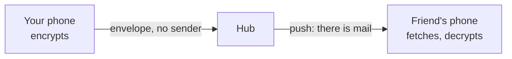

# Yo

**One tap, one Yo — end-to-end encrypted, and the server never learns who sent it.**

## YoIP: Yo over IP

The protocol between apps and server: **YoLS** for security, the **hub** for delivery, the **content** of a message.



### YoLS: Yo Layer Security

Chats are MLS groups (RFC 9420); keys renew every week or 100 messages. An account key signs your devices; any
contact can be checked with a 60-digit safety number.

### Hub

A mailbox. Messages arrive without a sender and padded to one of four sizes; a push only says "there is mail".

| The hub knows | The hub never learns |
|---|---|
| phone numbers (hashed), devices, IPs, timing, sizes | who sent a message, what it says, who chats with whom |

### Content

A Yo is 13 bytes: `00 01` version · 8 bytes time · `00 01` type Yo · `00` empty body.

Full protocol: [spec/v1.md](spec/v1.md).

## Speed

| Hub on one core | Yops | p99 |
|---|---|---|
| Database on an SSD | 16,000 | 19 ms |
| Database in RAM | 22,000 | 6 ms |

Yops: Yos delivered per second. One writer thread sets the pace, not the cores. [All runs](tests/README.md#load).

## Layout

| | |
|---|---|
| [`core/`](core) | formats, the client core (Rust), Swift and Kotlin bindings |
| [`hub/`](hub) | the server |
| [`tests/`](tests) | scenarios, simulation, fuzzing, load |
| [`app/ios/`](app/ios) | the iPhone app (mockup) |

## Run

```sh
dev/cargo test --workspace                                          # needs only Docker
dev/cargo run --release -p yo-tests --bin yo-load -- --clients 200  # load test
```

## License

[O'Saasy](LICENSE.md): use, change and share freely, but not as a competing hosted service.
