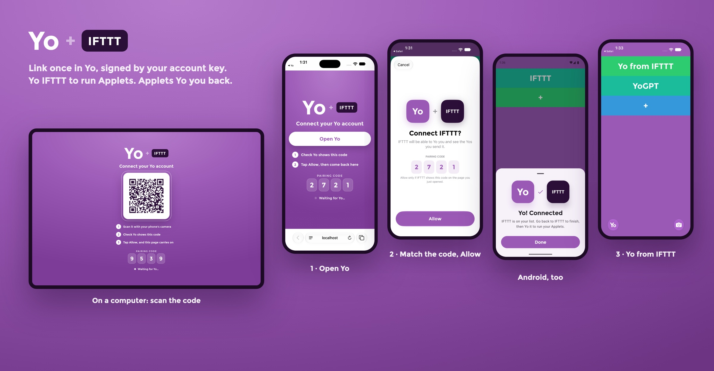

# IFTTT

Yo's service on [IFTTT](https://ifttt.com/yo): a bot account, IFTTT, and the
[IFTTT Service API](https://ifttt.com/docs/api_reference) it serves at `https://justyo.co/connect`. Yos are end to end
encrypted, so IFTTT sees only what is sent to it, as any friend would.

- **Trigger `you_yo_ifttt`** (You Yo IFTTT): each Yo, photo or video a linked user sends IFTTT, directly (not in a
  group). Kept: when and which kind, the last 50 per user; never the media (`listen --drain-media`), never a Yo from
  someone not linked. IFTTT is told at once (realtime API, by trigger identity).
- **Action `yo_me`** (Yo me): IFTTT Yos the linked user; with `photo_url`, an https JPEG of at most 512 KB as a photo
  Yo. A bad photo or a user who removed IFTTT is skipped (`SKIP`), not retried.

## Linking

OAuth 2 (authorization code), scope `ifttt`:

1. IFTTT sends the user to `/connect/authorize`. The page holds a ticket (random, 10 minutes, one try) and shows
   **Open Yo** on a phone (`yo://connect?origin=…&ticket=…`) and a **QR code** on a computer
   (`https://justyo.co/connect/approve?t=…`, drawn by `qr.py`, nothing loaded from elsewhere), with a four-digit
   **pairing code** from the ticket.
2. The app asks: *Connect IFTTT?*, with the same pairing code: a link someone else sent shows a code on no page the
   user opened. On Allow it signs the ticket with the account key, bound to the page's origin (spec 3.5,
   `core/wire/src/connect.rs`), and posts it to `/connect/approve`. The app only answers; it never opens the return
   link.
3. `yo verify` checks the signature against the account key the hub attests (a hub-signed lookup). The bot adds the
   user, so its Yos are no requests (spec 4.10); the app adds IFTTT.
4. The waiting page sees the yes and goes back to IFTTT with a code (5 minutes, once); `/connect/token` turns it into a
   token, kept as its SHA-256 only. Cancel goes back with `access_denied`.

## Running it

Beside the other skills (`../README.md`), one unit per hub, `yo-ifttt@.service`:

1. `yo register IFTTT` once, by hand, in the unit's `yo` state directory (`/var/lib/yo-ifttt-<hub>/yo`).
2. `/etc/yo-ifttt-<hub>.env` (root, 0600): the `yo` settings, and
   - `IFTTT_SERVICE_KEY`: the service's key, from the IFTTT developer console;
   - `IFTTT_CLIENT_ID`, `IFTTT_CLIENT_SECRET`: chosen here (`python3 -c "import secrets; print(secrets.token_urlsafe(24))"`),
     entered in the console's authentication step;
   - `IFTTT_TEST_USER`: the user id of a Yo account that exists only for IFTTT's endpoint tests, never a person's:
     each `/ifttt/v1/test/setup` replaces its token and gives it sample Yos;
   - optional: `IFTTT_SERVICE_SLUG` (`yo`), `CONNECT_ORIGIN` (`https://justyo.co`), `CONNECT_PREFIX` (`/connect`),
     `IFTTT_LISTEN` (`127.0.0.1:8095`, one port per hub).
3. The tunnel sends `justyo.co/connect/*` to the unit's `IFTTT_LISTEN`, path kept.
4. justyo.co's `apple-app-site-association` lists `/connect/approve` for the app (Android verifies the domain already).

On IFTTT the service is `yo`: trigger `you_yo_ifttt` (ingredients `received_at`, `kind`), action `yo_me` (field
`photo_url`), authorization `https://justyo.co/connect/authorize`, token `https://justyo.co/connect/token`, brand
colour Amethyst `#9B59B6`; `applet-logo.svg` is its white Applet logo.

**Trying it on one machine.** A hub (`cargo run -p yo-hub`), `yo register IFTTT` against it, and `ifttt.py` with
`CONNECT_ORIGIN=http://localhost:8095`; then Yo Dev in the Simulator with `YO_HUB` and `YO_CONNECT_ORIGIN` set to
them, or an Android debug build with `-PyoHub=… -PyoConnectOrigin=…` (the emulator reaches this machine at
`10.0.2.2`). The link ends on IFTTT (disconnect the service there); blocking IFTTT on Yo stops its Yos.

`python3 -m unittest discover skills/ifttt` checks the service without a hub (`cargo test -p yo-cli` runs it too).
