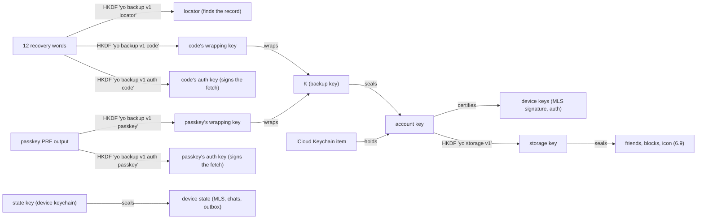

# YoIP v1: Yo over IP

Status: draft, implemented by `core/` and `hub/` in this repository; what is marked *(to build)* is decided and not
built yet.

YoIP is the whole protocol: identities, chats, the hub, what a message says. Its security layer is **YoLS** (Yo Layer
Security): identities and certificates (3) and chats as MLS groups (4), everything that keeps content and senders
secret. The rest, content (5), the hub (6) and devices (7), is YoIP around it.

The protocol is that of a full messenger; the v1 product sends one thing, a Yo. Everything a later version needs
(more devices, groups, text, verification) is in the formats from the start, so adding it is an extension, not a break.

## 1. Goals

1. **Content:** only the members of a chat can read it (MLS, RFC 9420).
2. **Sender:** the hub never learns who sends a message or a commit (sealed sender, 6.1).
3. **Social graph:** the hub never learns who is in a chat with whom: an envelope names its inbox and nothing else
   (6.1).
4. **Healing:** a stolen device state stops being useful after the next update (post-compromise security).
5. **Simplicity:** one suite, one encoding, one padding scheme, no negotiation.

What the hub does learn:

- **Accounts:** which devices and which username belong to which user; the platform and build each device's app last
  named (6.3).
- **Traffic:** when a user receives something and its bucket (6.1); the IP address of every request; that some group
  with a random id moved to a new epoch (4.3).
- **Lookups:** who looks up whom. A lookup is signed, so the hub sees that a device asked for a username, the intent
  to start a chat (and, once per contact, the check of who started one). Until private contact discovery (8), this is
  the one edge of the social graph it sees.
- **Reports and feedback** (6.4): whom a user reports; the feedback a user writes, which is plain to the hub.
- **Blobs** (6.8): who uploaded one, when, how large, for how many fetches (about the devices it goes to), and the
  addresses that fetch it; not what it shows, not its key, not who fetches it.
- **Storage** (6.9): that a user keeps one, its size to the KiB, when it changes; not what is in it.
- **Delivery tokens** (6.10): how many a device asks for and when, and under which of the hub's two keys a spent one
  was issued (the same for everyone: it says in which month); not to which device it was issued.

What can still tie deliveries to their sender, or the inboxes of one group together, is **address and time**: a
commit posted to `/v1/groups/{id}/commit` and, seconds later from the same address, envelopes to the members'
inboxes; a delivery from the address a device signs its requests from; a token spent seconds after its device
fetched a batch. The hub keeps no record of addresses or lookups beyond its in-memory rate limits, but a hub that
wanted to could. Oblivious HTTP would hide the address (8).

## 2. Primitives

| What | Choice |
|---|---|
| MLS | RFC 9420 through OpenMLS `=0.9.1` |
| Suite | `MLS_128_DHKEMX25519_CHACHA20POLY1305_SHA256_Ed25519` (0x0003), nothing else |
| Wire format policy | ciphertext only: application messages *and* commits are `PrivateMessage` |
| Encoding | TLS presentation language (RFC 8446 §3), like MLS itself, for every structure here; decoded strictly: trailing bytes are an error |
| base64url | without padding, padding refused (ids in paths, headers); padded only where Privacy Pass says so (6.10) |
| Account key, device auth key | Ed25519 |
| Seal | HPKE base mode (RFC 9180), DHKEM(X25519, HKDF-SHA256), HKDF-SHA256, ChaCha20-Poly1305 (6.1) |
| Hashes | SHA-256; SHA-512 for the safety number |
| Local state | ChaCha20-Poly1305 under a 32-byte key the platform keeps (Keychain, Keystore) |

## 3. Identities (YoLS)

Four layers, kept apart (Signal's ACI model; MIMI's split of identity and discovery):

| Layer | What | Changes? | Who sees it |
|---|---|---|---|
| **User id** | 16 random bytes the hub gives an account | never | the hub; contacts (to address and pin) |
| **Account key** | Ed25519; signs the account's devices | never: a new phone restores it from the backup (7) | everyone in a chat, everyone who looks you up |
| **Devices** | MLS signature key, auth key, device id each | added and replaced | MLS members see the signature key; the device id only the hub |
| **Handles** | a username; points to a user id | any time | whoever uses one to find you |

Each device has an **MLS signature key** (its leaf in every group), an **auth key** (signs its requests to the hub;
separate, so no key serves two protocols) and a **device id** (16 random bytes, the hub's name for its inbox; never
given to other users).

### 3.1 Certificate

The account key vouches for each device, and that is all a certificate says. It is the `identity` of the device's
MLS `BasicCredential`:

```
struct {
    opaque  account_key[32];
    opaque  signature[64];   // Ed25519 by account_key over "yo device v1" || the leaf's signature key
} DeviceCertificate;         // 96 bytes
```

The device key is not repeated: it is the leaf's signature key, and the signature covers it. The version is in the
label. The certificate names no person (no user id, no name) and carries no flag that would tell a
stranger anything about the account. A member is valid only if the certificate parses strictly and the signature
verifies against the leaf's signature key. Clients check this for every member of every group they join or see
changed; the hub checks it for every KeyPackage it stores.

### 3.2 Who an account key is

**The hub attests it.** It holds user id ↔ current account key ↔ devices ↔ handles and answers a lookup by any of
them (section 6.3). An account key belongs to one user id as long as that user exists: it is never accepted for
another, also after it was replaced; deleting or releasing the account frees it (6.4). A registration is signed by
the account key (6.4), so certificates and KeyPackages copied from somewhere cannot register anyone. The certificate
names no user id because it would prove nothing: only the hub can say whose a key is. Clients pin each contact's account key on
first contact and report a change for the same user id (`IdentityChanged`). A lying hub is caught by verification
(3.4); an auditable log of every key change (key transparency) is for a later version. Until then the hub is also
trusted with the list of a user's devices: a hub could bring back a device the user had replaced, if that device's
keys were stolen.

### 3.3 Handles

- **Username:** chosen at registration; an account may give it up later (`PUT /v1/username` with none) and is then
  found by user id only. 3 to 16 characters (grapheme clusters, NFC): Latin
  letters with their accents (`Ärger`, `José`), `0`–`9`, `_` and emoji (`🔥🔥🔥`, `🧙‍♂️Yo`), starting with a letter or
  an emoji. "Latin letters" are those of Basic Latin, Latin-1, Latin Extended-A and -B and Latin Extended
  Additional, with combining accents (U+0300–U+036F). An emoji is a whole sequence (UTS #51): one shown as emoji by default or made one by U+FE0F, a skin tone
  on one that takes it, a keycap, a flag, a tag sequence, or such emoji joined by U+200D; a digit with marks after
  it is none; no other scripts in v1, so no name mixes them. **Kept and shown as its owner writes it** (NFC, any case:
  `YoGPT`, `Christopher`); whoever finds the account by any spelling sees the owner's.
  **Two names that look alike are one name:** the hub keeps names unique by their *skeleton*: upper case, NFKD,
  without nonspacing marks, emoji variation selectors (U+FE0E, U+FE0F) and skin tones (U+1F3FB–U+1F3FF), then
  `0` → `O`, `1` → `I`, `VV` → `W`. So `Leo`, `LEO`, `LE0` and `LÉO` are one name, and so are 👍 and 👍🏿; the first to
  come has it. **Reserved names:** the hub keeps a list of names nobody may claim, which its operator maintains
  outside this repository; they are compared by skeleton too, so they are taken in every spelling. Reserving a name
  takes it from no one who has it already. Which names are reserved, the apps learn only as "taken". One per user;
  changed with `PUT /v1/username` (also to another spelling of the same name), the old one is then free for others.
- **Display name:** not a handle. It goes encrypted to chat members only, as a `Profile` message (section 5); the hub
  never sees it. A new one is due in every chat until told there: a chat that cannot take a message now (a blocked
  peer, a new key waiting for confirmation, a commit waiting for its answer) gets it with its next send or
  `maintenance`.

Handles appear in no certificate and no group: changing one touches no chat.

### 3.4 Safety number and verification

```
f(x)   = uint8(len(user_id)) || user_id || account_key
digest = SHA-512("yo safety number v1" || min(f(a), f(b)) || max(f(a), f(b)))
number = for i in 0..12: big-endian uint40(digest[5i .. 5i+5]) mod 100000, five digits each
```

60 digits, the same on both sides, compared aloud or by QR code. Any contact can be verified. Verification binds the
account key: it holds as long as the key does, across new devices of the same key (restored from the backup), and is reset,
with a warning, when the user's account key changes. For a contact that was verified, nothing more is sent to the new
key until the person confirms it (`confirm_identity`): the warning comes before the message, not after.

## 4. Groups (YoLS)

A chat is an MLS group. The group id is 32 random bytes. In v1 a chat has exactly two accounts; the formats allow
more accounts and more devices per account.

Configuration, the same on every device:

- extensions: `ratchet_tree` in the Welcome; required capabilities: basic credentials
- sender ratchet: out-of-order tolerance 50, maximum forward distance 1000
- past epochs kept for late application messages: 3

### 4.1 Epoch tokens

Every epoch has a token, known to its members only:

```
token(e) = MLS-Exporter("yo epoch token", group_id, 32)
```

The hub stores `SHA-256(token(e))` for the current epoch of every group. A commit is accepted only with the token
of the epoch it builds on. That proves membership without naming a member.

### 4.2 Creating a chat

1. Look up the peer (section 6.3): user id, account key and one KeyPackage per device.
2. Create the group, add every device of the peer (and the own other devices) in one commit, merge it: epoch 1.
3. `POST /v1/groups` with `group_id`, epoch 1 and `SHA-256(token(1))`.
4. Deliver the Welcome to each account in the group (section 4.6); every device of it receives it, each finds its
   own secrets in it, a device not in it ignores it.
5. Send a `Profile` (section 5) so the peer can show a name.

The group, its Welcome and its profile are made and saved before step 3, which runs outside anything that could
undo them (4.7). Until the hub answers `201`, they and the messages sent in the chat wait in the outbox, and the
same request is sent again with the next delivery (no answer, `429`, `5xx`); a `409` to a repeat is the answer to
the try before it, lost. A `409` to the first try, or another refusal, drops the chat with what waits in it.

The device that receives the Welcome checks every member's certificate and that the group holds exactly its own
account key and one other. Who the other is, it learns from a contact already pinned to that key or from the hub
(lookup by account key): the user id whose current key it is, and its username as its owner writes it, which the app
shows. A key that is no user's current key (the sender changed
phones meanwhile, or a forger) is discarded, and so is everything that follows in that group.

Sending to a username first asks the hub whose it is now (without taking a KeyPackage), also a name the device knows:
it may have changed hands since (3.3), and the contact that had it keeps it no more. If it is a contact already, the
existing chat is used, so answering someone who wrote first by their name opens no second chat. A send by user id
asks nothing.

### 4.3 Commits and their order

Two members may commit at once; MLS needs one order. The hub is the referee, per group:

```
POST /v1/groups/{group_id}/commit
  { epoch e, token(e), SHA-256(token(e+1)), the commit's envelope }
```

- `e` is the group's epoch at the hub and the token matches: accepted, the hub moves to `e+1`.
- `e` is older: `409` with the hub's epoch; the client drops its pending commit, receives the commit that won from its
  inbox, and may try again on top of it.
- the current epoch with a wrong token: `403`; a group the hub does not know: `404` (both lose the chat, 4.9).

Only after acceptance does the committer merge and deliver the commit to every account in the group. The
committer computes `token(e+1)` from its staged commit before the hub answers.

The hub keeps every accepted commit's envelope with its epoch (30 days; its next-token hash for good, for a lost
answer below) and hands it out by `GET /v1/groups/{group_id}/commits/{e}`. A member that meets a `409` and does not have the winning commit in its inbox
fetches it there: a committer that vanished after its commit was accepted holds nobody up.

**A lost answer.** The committer keeps the commit (and the request) until the hub has answered. Repeating it is
safe: the hub answers `200` to a commit for an epoch `e` it accepted with exactly that next-token hash, which only
this commit can produce, however far the group has moved on since. Until the answer is in, nothing is sent in the group. A commit from another member
for the same epoch, arriving meanwhile and checked like any commit, means the hub took that one; only then is the
own commit dropped.

**What a commit may contain.** Add, Update and Remove proposals only; a new leaf only with its sender's account key.
An Add is for a device of an account key already in the group, or for a user's new account key that replaces the old
one: then every receiver asks the hub that the new key is that same user's current key, and the commit removes all
devices of the old key. Anything else is refused. A device does not remove itself; one that finds itself removed
leaves the chat.

### 4.4 Updates (post-compromise security)

Every device commits an empty update (a new leaf: fresh encryption key, new path secrets) when:

- it joined the group and has not updated yet, or
- its last own update is 7 days old, or
- it sent 100 messages in the group since its last own update.

The check runs before every send and in `maintenance()`, which the apps call when they come to the foreground. An
update that cannot be made is tried again at the next check, and the send goes on; one sent and not yet answered
holds the group's sends until it is (4.3).

### 4.5 Two chats between the same people

Two people may create a chat with each other at the same moment. Both groups stay; the apps show one chat and send
on the group with the smaller id.

### 4.6 Delivery to accounts

A sender addresses **users, not devices**: `POST /v1/inbox/{user_id}`, and the hub copies the envelope to every
device of that user. A group's message or commit is one MLS ciphertext for all members, sealed once per account (6.1).
The own account is addressed only when the group holds other own devices; a device skips its own messages
(`OwnPrivateMessage`).

**Which devices.** With each delivery the sender names the devices of that user that the group holds now, as the
`Yo-Devices` header:

```
devices_hash = SHA-256("yo devices v1" || account_key || sorted device signature keys)
```

It is a routing precondition, computed when the envelope is sent, not when it was made. The hub compares it with the
user's current account key and devices and, in the same transaction, either stores the envelope for every device or
stores nothing and answers `409` with the current ones.

**Repair.** On a `409` (one whose devices cannot be read is a "not now": the envelope stays) the sender holds that
user's envelopes and brings the group in line in one commit (ordered by
the hub, 4.3): devices the user no longer has are removed, missing ones added, with KeyPackages fetched only for the
missing devices (`lookup` with `except`). The commit goes to every account, its Welcome to that user's account; a
device that cannot use one of them (a new device and the old-epoch commit, an old device and the Welcome) skips it
quietly. A lost race to another commit is resolved like any (4.3): receive or fetch the winner, recompute, try again,
up to three times. Then the held envelopes:

- **Some of the user's devices remain:** they are sent again as they were. The remaining devices get everything in
  order; a new device sees the chat from its joining on.
- **None remains** (a new phone): what was held is dropped, and the messages among it are encrypted anew in the new
  epoch, for that user only, behind the repair's Welcome and commit (a new device cannot read them before it
  joined), with what was queued for that user after them behind them again. Every device gets every message once.

The cases:

- **Same account key, other devices** (a new phone restored from the backup; later a second device): devices removed
  and added; contacts see nothing.
- **New account key** (in v1 only from a hub that lies, 3.2): the old devices removed, the new added,
  in the same chat; `IdentityChanged`, and a verification is reset (3.4).

### 4.7 Sending and receiving

- **Receive before send.** A send first processes what waits in the inbox, so a message is never encrypted in an
  epoch the peer has already left; unless the inbox is up to date already: a long wait for it is under way (which
  brings what arrives at once) or it was emptied in the last 5 seconds. Three past epochs are kept for what crosses a commit in
  flight.
- **Outbox.** Envelopes go into an ordered outbox before they are sent and leave it only when the hub accepted
  them; per group in order, so a commit arrives before the messages of its epoch. Each remembers the devices it was
  encrypted for, so a repair can encrypt it anew (4.6). Without network a send still succeeds into the outbox.
- **A user gone.** A delivery answered `404` names a user the hub no longer has (the account deleted, or its name
  released, 6.4): the envelope is dropped, and so are the chats with that user; the contact is kept as gone, without
  its handles (a name it had may be a stranger's now, found anew by asking the hub), and a send to it is `NotOnYo`.
- **Not now, before sending.** A send that cannot receive first for now (no network, `429`, `5xx`) still goes into
  the outbox; one to a username fails then, as it cannot ask the hub whose it is (4.2).
- **Fetch and ack.** The inbox is fetched, every envelope processed, the state saved, then acknowledged: at least
  once. The device remembers the hashes of the last 2000 MLS messages it opened (inside the seal, so two sealings of
  one are one) and skips a second copy. A lost ack costs a
  repeat, nothing else. What arrived is handed to the app as soon as it is saved; the ack, and the work a receive
  leads to (KeyPackages, the outbox, the storage, delivery tokens), come after it (`after_sync`, else first thing in
  the next `sync`), so neither stands between a Yo and the app; only a full batch (100) is acknowledged before the
  next is fetched. An extension using the app's state (a guest) only
  reads and acknowledges; the rest is the app's.
- **Save before it leaves.** The state is saved before the outbox is sent, so a crash cannot bring back a ratchet
  state whose keys already encrypted something; so are a commit, KeyPackages and a registration before they go to the
  hub, and what was received before its ack. A save that fails (a full disk) fails the call: nothing that needed it
  leaves, a new message is not made, the inbox is not acknowledged.
- **Not now is not never.** An envelope that meets a passing refusal (no network, `429`, `5xx`, `507`) stays and is
  tried again later; only one wrong in itself is dropped: received, one that does not open or verify; sent, one the
  hub answers `400`, `404` or `413`. A `426` (an app too old, 6.3) passes as
  well: what waits to go (the outbox, a new or a lost chat) is kept for the updated app. Events are never lost: they
  are saved with the state until handed to the app, and kept until the app acknowledges them (or makes its next
  call). A crash in between brings them again: once in normal operation, at least once across a crash.
- **Nothing the hub accepted is rolled back.** What talks to the hub never runs inside a transaction that could undo
  it. Inbox ids are never reused, so an ack
  removes only what was fetched.

### 4.8 Blocking

Blocking is the device's own: the hub cannot do it, because it never learns a sender (goal 2). A blocked user's
Welcome is joined quietly (no new chat is shown, no update or name goes to them, and the chat works again after unblocking), their messages are dropped unseen, also those received but not yet handed to the app
(commits are still processed), and nothing is sent to them (`Blocked`): what waited in the outbox for them when they
were blocked (a message made offline, a Welcome, a commit) stays there unsent, and goes, in its order, only after an
unblock, so the chat works then; it does not count as waiting meanwhile. They are not told. A handle the device does
not know yet is looked up (without a KeyPackage) to block the user before the first Yo.

### 4.9 A chat restarted

A device that cannot follow a group any more restarts the chat. It happens when a commit it lacks is gone from the
hub: a device away longer than the hub keeps envelopes and commits (30 days, 6.6) while the peer's chat moved on.
A message from an epoch the device has not reached makes it fetch the missing commits (4.3), each of which must move
the group on. The hub answers `410` for a commit it accepted once and no longer keeps, `404` for one it never had (an epoch
before the one the group was registered at, or not reached yet): a
message whose epoch was made up (anyone may deliver, 4.6) is dropped and the chat goes on. At most 1000 commits are
fetched in one call; the rest come with the next, and what was fetched is kept. Until the group stands at the epoch
the hub named for it (a lost race, 4.3), nothing is encrypted in it: the send fails for now. On a `410` (also while
catching up after a lost race) the chat is lost to this device; so it is when the hub refuses a commit with `403` or
`404` (it does not order the group, or not with this device's token): a chat is never kept without updates (4.4).
What waits to go in a lost chat waits for its restart; one with a blocked peer, and what is held for them, is
restarted only after the unblock (4.8). Then, at its next call:

1. It creates a new group with the peer (4.2: lookup, Welcome, profile), drops the old one and ignores what still
   comes in it.
2. It sends in the new group, first, a `Restart` (content type 6, silent): `uint64 last_seen`, the `sent_at` of the
   last message it received from the peer; then what was still waiting to go in the old group.
3. The peer joins the new group as any. When the `Restart` arrives, it drops its older chats with the sender (those
   not restarted themselves) and sends again, in the new group, every message it sent in them that it keeps (each
   device keeps the plaintexts of the last 64 messages it sent in a chat, sealed in its state) and what of them was
   still waiting to go, in the order sent. Not only those after `last_seen`: that is the latest message that came,
   not all that came (one may have been lost before a later one arrived). Nothing is shown for a `Restart`.

A device's messages are sent with strictly increasing `sent_at`, so no two are the same plaintext; a receiver
remembers the last 2000 it showed (by sender and plaintext) and skips a copy sent again. What arrived is shown once
(unless more than 2000 came after it); what was lost with the old group comes again, in order. Two sides that restart at
the same time each keep the other's new group and their own (until the peer writes in it), send on the smaller id
(4.5), and answer each other's `Restart` from the plaintexts of every chat with the peer. A device keeps at most 4
chats with one peer: a Welcome beyond them (made again and again with its last resort KeyPackage) pushes out the
oldest, so nobody can make it keep groups without end. A restart needs the hub's
answer for the peer's own user id; the chat is restarted with nobody else. A peer whose new key waits for confirmation
(3.4) is restarted with after it.

## 5. Content

The plaintext of every application message. Everything a person sends is a Yo; what it carries besides (a text, a
link, a place, a photo) hangs on it, so an app that does not know a part still shows the Yo.

```
struct {
    uint16  version = 1;
    uint16  type;
    uint64  sent_at;              // milliseconds since the epoch, sender's clock
    opaque  body<V>;
} Content;
```

| type | body | |
|---|---|---|
| 1 `Yo` | empty, or `With with<V>` | sound, the sender on top, "Yo" on their bar |
| 2 `Profile` | `opaque name<1..32>` (UTF-8, no control characters) | silent: the name to show |
| 6 `Restart` | `uint64 last_seen` | silent: the chat restarted in this group (4.9) |

```
struct {
    uint16  kind;
    opaque  data<V>;
} With;                           // what a Yo carries; at least one, sorted by kind, each kind once
```

| kind | data | |
|---|---|---|
| 1 text | UTF-8, 1–4096 bytes, no control characters | later |
| 2 link | URL, 1–2048 bytes | later |
| 3 location | `int32 lat_e7; int32 lon_e7` | later |
| 4 photo | `Media` | a JPEG or HEIC |
| 5 video | `Media media; uint32 duration_ms` | an MP4 or QuickTime movie |

```
struct {
    opaque  id[16];               // the blob at the hub (6.8), random, chosen by the sender
    opaque  key[32];              // random, used for this blob only
    opaque  sha256[32];           // of the ciphertext
    uint32  size;                 // of the ciphertext
    uint16  width;
    uint16  height;
} Media;
```

**Photos and videos.** The sender's app makes a photo a JPEG (or HEIC) of at most 1600 pixels on its longest side,
a video at most 10 seconds and about 8 MB, both without metadata (no place, no device). It seals the file under a new
random `key` with ChaCha20-Poly1305, nonce zero (the key is used once), no associated data; the ciphertext (the file
and the 16-byte tag, at most 10 MiB) is the blob (6.8). A receiving device
fetches the blob, checks its size and hash and opens it; the app keeps it until it has been seen once, then deletes
it with its key (view once). A blob the hub no longer has leaves the Yo without the picture. The same `Media` sent
again to a peer (an app that lost its answer) goes once, as long as the device keeps that sent message (64 per chat,
4.9).

A plain Yo is 13 bytes, one with a photo 108. An unknown kind is skipped and the Yo shown; of a photo and a video,
v1 shows the photo. An unknown type is reported (`Unsupported`), never an error; an unknown `version` is an error. One encoding per value: a Yo with nothing carries an empty body, never an empty list.
*(The order of the fields is to build; `core/wire` still has `sent_at` before `type` and `Text`, `Link`, `Location`
as types of their own. `With` is built, for photos and videos.)*

## 6. The hub

### 6.1 Envelope

Everything delivered to an inbox is an envelope: the MLSMessage (a Welcome, or a PrivateMessage: a message or a
commit), padded, then sealed to the recipient's account.

```
uint8  version = 2
opaque kem_output[32]
opaque ciphertext[...]           // HPKE seal of Padded, its 16-byte tag included

struct {
    uint8  version = 1;
    uint32 length;
    opaque mls_message[length];
    opaque zeros[...];           // up to the bucket less the seal's 49 bytes
} Padded;
```

The seal is HPKE (2), info `"yo sealed envelope v1"`, no AAD, to the recipient's **account key** in its X25519 form (the birational map of the
Ed25519 key; the private key is the account secret's clamped scalar). The sender takes the account key its
recipient's members in the group are certified by (3.1), so there is nothing to publish and nothing the hub could
put in its place; every device of the account holds the account secret and opens it. Each envelope is sealed on its
own, so two copies of one message are different bytes. An envelope that does not open is dropped.

The envelope is exactly one bucket: 1 KiB, 4 KiB, 16 KiB or 64 KiB, the smallest that fits. The padding is inside
the seal, zeros, and checked by the recipient. The hub checks only the size and the version (`400` otherwise) and
sees a bucket and an inbox: not the group, the epoch, the kind or the length.

A commit posted to `/v1/groups/{id}/commit` (4.3), and fetched from there, is unsealed: `Padded` up to the whole
bucket (no seal to leave room for), as that route names its group anyway. Its copies to the members' inboxes are sealed like everything else.

The seal came in November 2026 as a clean break: at its deploy the hubs' `YO_MIN_APP` is raised to the first build
with it (6.3); what an older build still had in its outbox is refused (`400`) and dropped.

### 6.2 Signed requests

Requests on behalf of a device carry three headers:

```
Yo-Device:    base64url(device id)
Yo-Time:      milliseconds since the epoch
Yo-Signature: base64url(Ed25519 by the auth key over SignedRequest)

struct {
    opaque label<V> = "yo request v1";
    opaque method<V>;
    opaque path<V>;              // with query
    uint64 time;
    opaque body_hash[32];        // SHA-256 of the body
} SignedRequest;
```

The hub accepts a time within 5 minutes of its clock and each signature once (a replay cache over that window). A
device signs with strictly increasing times, also across the processes that share its state (the app and its
extensions) and across a restart: the last time signed is saved with the state. A `401` is answered by signing the
request anew, once: the same request at the same millisecond (two processes, or a crash before the time was saved)
is the same signature, which the hub took already, and a request refused so was not processed.

A backup record's fetch (7) is signed the same way, by one of the record's auth keys instead of a device's: `Yo-Time`
and `Yo-Signature` only, the same window, the same replay cache. Whatever fails is `404`, as for no record.

### 6.3 Endpoints

Bodies are TLS-encoded structs (`application/octet-stream`); `wire` defines each one.

**The app's version.** Every request of an app names it in `Yo-App: PLATFORM/BUILD` ("ios/202611140619"; the
platform in lower case letters, the build a number). It is not signed. The hub keeps the last one each device named,
in the clear, and answers any request of an app older than its minimum for that platform (the operator's
`YO_MIN_APP`) with `426`: the app shows that it must be updated and sends nothing more. A breaking change raises the
minimum. A request without `Yo-App`, or of a platform without a minimum, passes.

| Endpoint | Auth | Does |
|---|---|---|
| `POST /v1/register` | – | username + certificate + first KeyPackages → device registered; answers the user id and its username (6.4) |
| `GET /v1/username/{name}` | – | is the username free? The name as written (NFC), its UTF-8 percent-encoded; `204` free, `409` taken (by skeleton, in any spelling, 3.3) or reserved, `400` no username; nothing else is told |
| `GET /v1/backup/{user id or locator}` | signed by a door's key (6.2) | the account's backup record, encrypted (7); `404` if none, and for any request not signed by one of its doors' auth keys |
| `PUT /v1/backup` | signed | store the account's backup record with its doors' auth keys, replacing the one before (7) |
| `PUT /v1/keypackages` | signed | add KeyPackages; one may be `last_resort` |
| `POST /v1/lookup` | signed | a handle (username in any spelling, user id, account key) → user id, account key, device keys and, if asked, one KeyPackage per device (`key_packages` bit 0) and the username as its owner writes it (bit 1: `LookupNamed`) |
| `PUT /v1/username` | signed | change the account's username |
| `DELETE /v1/account` | signed | delete the account (6.4) |
| `POST /v1/report` | signed | report a user: `Report { user_id, uint8 reason }`, 1 spam, 2 abuse, 3 other; `404` no such user |
| `POST /v1/feedback` | signed | feedback on the app for the operator: `Feedback { text, app_version }`, the text 1 to 2000 bytes of UTF-8, the version at most 64; plain to the hub (1) |
| `GET /v1/storage` | signed | the account's storage, sealed (6.9): `Storage { version, data }`; `404` none yet |
| `PUT /v1/storage` | signed | replace it: `Storage { version it replaces, data }`; `409` with the current one if that is not the hub's version (6.9) |
| `PUT /v1/push` | signed | set the device's push token |
| `GET /.well-known/private-token-issuer-directory` | – | the key delivery tokens are issued under now (6.10) |
| `POST /v1/tokens` | signed | a batch of blinded token inputs evaluated, up to 100 (6.10) |
| `GET /v1/inbox?wait=s` | signed | envelopes waiting, oldest first; waits up to `s` seconds if none |
| `POST /v1/inbox/ack` | signed | delete envelopes by id after they were processed |
| `POST /v1/inbox/{user_id}` | **none**, a token if it has one | deliver an envelope to every device of a user (sealed sender), `Yo-Devices` checked (4.6); a token in `Authorization` instead of the address's limits (6.10), `401` for one refused |
| `POST /v1/groups` | **none** | register a new group: id, epoch (1 to 2³²−1), token hash; `201`, also for the same registration again while the group has not moved on (a lost answer); `409` if the id is taken |
| `POST /v1/groups/{id}/commit` | **none**, token | order a commit and keep its envelope (section 4.3) |
| `GET /v1/groups/{id}/commits/{e}` | **none** | the envelope of the commit accepted on epoch `e`; `410` accepted once and no longer kept, `404` never (4.9) |
| `PUT /v1/blobs/{id}?fetches=n` | signed, by the body's hash | store a photo or video, encrypted, for `n` fetches (6.8) |
| `GET /v1/blobs/{id}` | **none** | the blob; a complete fetch counts, the last deletes it (6.8) |

Answers worth naming: `404` unknown, `409` epoch moved on (commit), devices changed (delivery, with the current
account key and devices), username taken (registration, change, check), locator taken (backup) or blob id taken,
`410` this device was replaced or its account removed or deleted (to its own signed requests, for a year; then
`401`) or a commit no longer kept (4.9), `429` rate limit or quota, `503` the hub's queue of deliveries is full (try
again), `507` no room for blobs now (or, for deliveries, commits and new groups, on the database's disk; for a
delivery, also a recipient whose inbox is full).

### 6.4 Registration

A username is all it takes, for people and for programs alike. `POST /v1/register` takes the username, the device's
certificate, auth key, device id, push token and first KeyPackages, all in one request, signed by the account key over
`"yo register v1" || Handle(username) || device id || device key || auth key` (`Handle` as `wire` encodes it for a
lookup), and answers the user id and the username it
has, as its owner writes it (`Registered { user_id, optional<username> }`):

- **An account key that is a user's current key** (a new phone that restored it from the backup, 7): that user,
  whatever username the request names; it keeps the name it has now (changed since the backup, or none), and the name
  in the request is not taken. Its devices are replaced, their own requests answer `410` from then on.
- **Another key and a free username:** a new user with a new random user id; the account key becomes its key.
- **Otherwise** `409`: the name is taken (or the key was once another user's).

First come, first served; limited per IP (6.6), nothing more. The request is saved before it leaves (4.7), so a
crash after the hub took it loses nothing: started again, the device finishes it from its state. A registration whose answer does not come is asked about first: the device looks up its own account key,
signed by itself, and is registered if the hub knows it (`401` if not); only then is the same request sent again.
Never with a new key: that would find the name taken by itself (an app whose state is gone tries again with the
same key, a new device; the name is this key's and it is that user again). The name is the user's at once; the backup (7) comes
after, when the user secures the name. **A name not secured is released:** a user without a backup record whose
devices have made no signed request for 365 days (counted to the day) is removed with its name and account key,
which become free; its devices' own requests answer `410`. A secured name is kept for good. The app reminds a week
before, counted from the last time it was opened.

**Deleting an account** (`DELETE /v1/account`, from any of its devices) removes the user the same way, at once and
with everything the hub holds about it: name, account keys, devices with their KeyPackages and waiting envelopes, the
backup record, the storage (6.9), the reports by and about it. Its feedback stays, without the sender: the user id it names becomes 16
zero bytes, which no user has. The name and the key are free again; the devices' own requests answer
`410`. Chats are not told: the peer's next delivery finds no such user.

**Reports** (`POST /v1/report`) are for the operator, who reviews them and may remove an account. A report names the
user and a reason, nothing of what was sent (the hub has none); one per pair is kept, the latest. Reporting oneself is
`400`.

**Feedback** (`POST /v1/feedback`) is for the operator too: what a user writes about the app, as written, with the
app's version, the user and the time. It is not end-to-end encrypted (the app says so where it is written) and is
kept until the operator deletes it, also after the account is gone (then without the sender, above).

### 6.5 KeyPackages

The hub checks every KeyPackage: suite, signature, lifetime, certificate (it verifies against the leaf's signature
key, and its account key is the uploader's user's). Each one is handed out once, except the `last_resort`, which is
handed out when no other is left. A KeyPackage the hub has ever seen is refused a second time, so a replayed upload
cannot bring back a used one. `GET /v1/inbox` reports how many are left; the core refills to 50 below 20. A refill is saved before it goes and
sent again unchanged until the hub answers; `409` (taken already) counts as done, `400` makes a new one.
KeyPackages live a year; the last resort is replaced every 30 days. One within a day of its lifetime's end is no
longer handed out or counted as left (the hub deletes it): the last resort goes instead, and the device refills. The one before is retired once the hub has
taken its replacement (not when that was made: its upload may fail for a while), and its private keys are kept 31
days more, for a Welcome made with it that may still wait. The private keys of any other KeyPackage are deleted a
day after its lifetime ends.

### 6.6 Limits

Every rate is a bucket that refills evenly over its period (a day's 200 are a burst of 200, then one every 7
minutes), kept in memory: a restart refills them. The blob quotas are the exception: per UTC day, in the database. IP limits count IPv6 by its /64 (an IPv4-mapped address as IPv4).

| What | Default |
|---|---|
| a request's body | 65 KiB (a blob 10 MiB, 6.8) |
| KeyPackages | 4 KiB each, 100 per upload |
| `inbox` | 100 envelopes per fetch, waits at most 60 s; 1000 ids per ack |
| push token | 512 bytes |
| `register` | 10 per IP per hour |
| `username/{name}` (is it free) | 60 per IP per minute: enough to ask while typing |
| `backup` (fetch) | 10 per IP per hour |
| `report` | 20 per user per day |
| `feedback` | 10 per user per day |
| `storage` (read and write) | 120 per user per hour; 60 KiB sealed |
| a name not secured | released after 365 days without a request (6.4) |
| `lookup` with KeyPackages | 50 per device per day |
| `lookup` of the account key only | 1000 per device per day |
| signed requests | 1200 per device per minute, counted once the signature holds |
| inbox fetches under way | 4 per device at once |
| deliver | 200 per IP per minute: one sender (see below); with a token, none |
| delivery tokens | 200 per device per day, at most 100 at once; the key replaced every 30 days (6.10) |
| envelopes waiting for a device | 5000; more is `507` until it is read (that recipient's room: the sender's other deliveries go on) |
| `groups` (create) | 60 per IP per hour |
| commits (posted and fetched) | 600 per IP per minute |
| deliveries and commits, their bytes | 64 MiB per IP per hour; a delivery with a token not counted |
| the database's disk | deliveries, commits and new groups `507` while it has less than 1 GiB free |
| envelopes kept | 30 days |
| a blob | 10 MiB, for 1 to 32 fetches |
| blobs (photos and videos) | 2000 per user per day (UTC), and 2 GiB |
| blobs waiting for their fetches | 1 GiB per user |
| blob uploads | 120 per IP per minute, 4 of one user at once |
| blob fetches | 600 per IP per minute |
| blobs kept | until their last fetch, 30 days at most |
| all blobs | 16 GiB; none while the disk has less than 4 GiB free (the operator sets both) |

**Deliveries are limited per sender by address:** a delivery is not signed, so that the hub does not learn who
writes to whom (goal 2), and the address is all it knows of the sender; an IPv6 /64 is about one phone, while phones
behind one carrier IPv4 address share it. A delivery with a good token (6.10) counts against no address, so they do
not share one limit. A delivery over the limit is `429`: the
envelope stays in the sender's outbox (4.7), the rest of the outbox waits behind it in its order, and the client sends
again after a second, then less and less often (up to half a minute) until the outbox is empty; it keeps receiving
meanwhile. The bucket refills evenly, so a burst goes out at the limit's pace and nothing is lost. There is
deliberately no rate per recipient: anyone who knows a user id could spend it and shut out every other sender. The cap
on waiting envelopes bounds what a stranger can store (`hub/SECURITY.md` weighs the rest).

Behind Cloudflare the hub takes the IP from `CF-Connecting-IP`, and only when configured to; it must then be
reachable through Cloudflare alone (a tunnel, listening on 127.0.0.1), or anyone could name any address. A request
from loopback without that header is the server's own and passes the IP limits.

Deliveries are stored by group commit: whatever has queued up goes into one transaction, so the hub's write
rate grows with load instead of being bounded by one transaction per envelope (tests/README.md has the numbers). A
queue that is full answers `503`.

### 6.7 Push

After storing an envelope the hub wakes the device: APNs with a constant alert and `mutable-content` (the
notification extension fetches, decrypts and shows "YO from CHRIS"), FCM as a data message. A push carries nothing
but "there is mail". On iOS the notification extension also fetches a photo or video of up to 6 MiB before it shows
the notification, on the device's one fetch (6.8): the app and the extension claim a blob before either fetches it,
so one fetch is under way at a time (a claim older than 90 s is taken over).

### 6.8 Blobs

Photos and videos travel beside the Yo that names them (5): the hub keeps their ciphertext, one file each, until
every device it is for has fetched it.

**Upload** (`PUT /v1/blobs/{id}?fetches=n`). Signed (6.2); the body is the ciphertext, and its SHA-256 comes ahead
in the `Yo-Body-SHA256` header (base64url), which is the `body_hash` signed. So the hub checks the request, the
uploader's quota and the room for the blob before it takes the body, and keeps the body only if it hashes to the
signed value and has the `Content-Length` announced. `fetches` is the number of the chat's devices other than the
uploading one (its own other devices too), 1 to 32. The hub never learns which devices those are: the recipients stay
as unknown to it as the sender of the Yo (goal 2). `201` stored; `409` the id is taken (the uploader's own earlier try,
whose answer was lost: the id is random), once that try is done; `503` while it is still on its way; `400` shorter
than a tag (16 bytes); `411` no `Content-Length`; `408` not all there within 5 minutes; `413` larger than 10 MiB;
`429` the uploader's quota (6.6) or a rate; `507` the hub has no room now. `429`, `503` and `507` are "later": the app keeps the photo or video, with its Yo, and tries again,
signed anew, until it goes; the Yo is sent after the upload, never before.

**Fetch** (`GET /v1/blobs/{id}`). No identity, limited per IP: the 128-bit id, known only to the chat's members from the
encrypted Yo, is the capability. A fetch counts when the hub has handed on its last byte; one cut off before does not.
Each takes one of the `n` as it starts and gives it back if it is cut off, so fetches at once never pass `n` (a fetch
while all the others are under way is `404`). When the `n`th fetch is complete, the blob is deleted at once, row and
file. Whoever knows the id may spend a fetch; only the chat's members know it. `404`: unknown, fetched by all (or
being fetched), not stored whole yet, or past its time.

**Time.** A blob not fetched by all within 30 days is deleted then (a device that stayed offline, or was replaced).
Deleting an account deletes the blobs it uploaded. The hourly cleanup also removes files no blob owns and uploads
cut off for an hour. A blob is handed out only once its file is in place; one a crash left before that is removed at
the next start, so the upload, sent again, is stored anew rather than found taken.

**Room.** The operator gives blobs a budget and a disk floor (6.6); an upload that would pass either is refused with
`507` until fetches and time have made room. The files are not part of the database's backup: after a restore, the
blobs are gone, and their Yos come without their pictures.

### 6.9 Storage

What the user keeps beside the chats, so that a new phone has it back with the account (7): the friends (by user id,
with the name the user gave each and the colour the app shows it in, or taken off the list), the blocks (4.8), and the
app's settings (for now its icon: none, `Negative`, `Original`). One blob per user, sealed by the device:

```
key  = HKDF(the account key's secret, "yo storage v1")         // 32 bytes; the hub never has the account key
data = nonce (12) || ChaCha20-Poly1305(key, nonce, pad(JSON), associated data "yo storage v1" || user id)
pad(x) = uint8 1 || uint32 length(x) || x || zeros   // as an envelope (6.1): data is then 1, 4, 16 or 60 KiB,
                                                     // the smallest that fits
JSON = { "version": n, "friends": { "<user id>": { "n": name, "c": colour, "b": blocked, "r": removed } },
         "icon": F, ... }                    // each field [value, ms when set]; one never set is left out
```

`version` is the hub's version the blob was written as: one read under another number is a replay, and is ignored,
as is a blob that does not open (the hub could as well have said there is none); the device's own takes its place at
once, also with nothing changed on it. A friend's name is at most 64 bytes. A few hundred
friends fit in the hub's limit; past it, friends taken off the list are forgotten first, the longest gone first; a blocked one never. A
blob sealed before the padding holds the JSON itself, spaces after it: its first byte is `{`, not 1, and it still
opens.

Two versions merge, the same on every side:

- a `[value, ms]` field by its time, the later winning; at equal times the value whose JSON is larger bytewise;
- an object field by field, the friends as the union of both;
- fields a device does not know are kept on every level and merge by these same rules.

The hub keeps the blob with a version number per user and takes a `PUT` only for the version it has now (`0`: none
yet), storing it as the next; otherwise `409` with the one it has, which the writer opens, merges into its own and
writes again, up to four times a call (then at the next). So two writers (two devices, later; an old and a new phone meanwhile) never overwrite each other
unseen.

A device writes after a change (at once, beside the inbox's long wait; else with the next `sync` or
`maintenance`; kept in the state until then, like the outbox), and reads once: a restored phone right after registering (6.4), and before it receives anything, so a block
holds from the first message. Blocks this device had before it knew the storage go up with its first write. A hub
without storage answers `404`, and the device leaves it at that. Deleting the account deletes the storage; a new key
(a new account) cannot open an old one.

### 6.10 Delivery tokens

A delivery may carry a Privacy Pass token (RFC 9576) instead of being counted against its address (6.6). The hub is
issuer and verifier at once: privately verifiable tokens, type `0x0001`, VOPRF(P-384, SHA-384) (RFC 9578, section
5; RFC 9497). A device gets them in batches, signed; it spends them on deliveries, unsigned; the hub evaluates each
token input blinded, so the token that comes back is one it has never seen and cannot tell whose it is.

**The key.** `GET /.well-known/private-token-issuer-directory` is the issuer directory (RFC 9578, section 4), the same
for everyone:

```
{ "issuer-request-uri": "/v1/tokens",
  "token-keys": [ { "token-type": 1, "token-key": base64url(SerializeElement(pkI)), padded } ] }
```

The key is derived from a random seed (`DeriveKeyPair(seed, "PrivacyPass")`), kept in the hub's database, and replaced
every 30 days; the directory names the one issuing, and tokens of the one before are still taken, for 30 to 60 days
of life in all. `token_key_id = SHA-256(pkI)`; two keys in use never share its last byte.

**The challenge.** Every Yo token answers one TokenChallenge (RFC 9577, section 2.1.1), which the client makes itself
(the hub sends none): `token_type = 0x0001`, `issuer_name = "yo"` (not the hub's host name, under which it may be
reached several ways; its key tells hubs apart), no `redemption_context`, no `origin_info`.

**Issuance.** `POST /v1/tokens`, signed, with an `AmortizedBatchTokenRequest` (draft-ietf-privacypass-batched-tokens,
section 5; `<V>` a QUIC variable-length integer, as MLS's):

```
token_input = 0x0001 || nonce (32, random) || SHA-256(challenge) || token_key_id
struct { uint16 token_type = 0x0001; uint8 truncated_token_key_id;          // the key id's last byte
         uint8 blinded_elements[49]<V>; }                                   // Blind(token_input), 1 to 100
struct { uint8 evaluated_elements[49]<V>; uint8 evaluated_proof[96]; }      // the answer, 200
struct { uint16 token_type; uint8 nonce[32]; uint8 challenge_digest[32];
         uint8 token_key_id[32]; uint8 authenticator[48]; } Token;          // after FinalizeBatch
```

One proof covers the batch and is checked against the directory's key before the tokens are kept. `422`: another
type or key, no element or more than 100, an element that is no point; `429`: the device's 200 a day are used up.
A batch of 1 to 100 counts against them also when it is refused for its type, key or points. The hub keeps nothing of a batch: neither what was blinded nor what it answered.

**Redemption.** A delivery may carry one token: `Authorization: PrivateToken token="base64url(Token)"` (RFC 9577,
section 2.2, padded). The hub checks the type, the challenge digest, the key (one of its two) and the authenticator
(`Evaluate(token_input) == authenticator`), and that the nonce was not spent (looked up first, before the costly check): then the delivery counts against no
address limit, and the nonce is spent in the transaction that stores the envelope, whatever its outcome (`202`,
`409`, `404`, or `507` for a full inbox). A token that fails is `401`, counted against the address like a delivery without one (whose
`429` comes first); past 30 of those a minute from one address (a bucket like the others), the hub checks no more tokens
from there until it refills, as each check costs it work and a forged one costs nothing to send. The hub keeps
spent nonces with their key and deletes them with it: nothing ties a nonce to the batch it came from.

**The client.** It keeps a stash of tokens with the key they were made for, in its state, and spends the oldest
first, so a fresh batch is used only once the older ones are gone (time between issuance and use, 1). Below 20 (with
`sync` and `maintenance`), it reads the directory, drops the stash if the key changed, and fetches a batch up to 100.
Each delivery takes one; one that never reached the hub (held behind another, no network) goes
back. A delivery answered `401` is sent again at once without the token, and the next refill reads the key whatever
the stash. Every failure is quiet: a hub without tokens (`404`), its daily limit, no network, a batch whose proof fails
leave deliveries as they were, without tokens and limited by address, and the next try is an hour later. A delivery
never falls back to anything signed: without a token it is the anonymous delivery of 4.6, never one that names its
sender.

The hub sends no `WWW-Authenticate: PrivateToken` challenge with its `401`: the client needs none, and Apple's URL
loading answers such challenges itself (Private Access Tokens) for issuers it knows.

## 7. Backup and a new phone

| Case | Account key | User id, username | Contacts see |
|---|---|---|---|
| New phone, from the backup (passkey or code) | restored, same | same | nothing; verification holds |
| New phone, no backup | new | a new account, a new name | a new person |

**On iOS, the iCloud Keychain first.** The app keeps the account (name, user id, account key, and the recovery words
when it has them) in one synchronized keychain item per account and hub, end-to-end encrypted by Apple. On a phone with no account
it registers with that key at once (6.4), before the welcome offers anything: the app installed again, or a new
iPhone, is back without a word, and the phone the account was on is signed out. Signing out marks the item signed
out: it is listed to sign in again with a tap, and no start brings the account back by itself, on this phone or on
the person's others. Deleting the account deletes the item; a phone whose account was taken by another keeps it and
does not take the account back unasked. The passkey and the recovery code remain the way in without the Apple
Account.

**The keys at a glance.** The account key is the primary key: it is who you are (3). The other keys either protect
it (the backup), are certified by it (the devices), or are derived from it (the storage).



| Key | What it is | Where it lives | What it opens |
|---|---|---|---|
| **Account key** | Ed25519; the identity, never changes | the phone's state; sealed in the backup; on iOS the iCloud Keychain (end-to-end encrypted by Apple) | registers new devices (6.4), certifies them (3.1), derives the storage key |
| **Device keys** | MLS signature key, auth key; new on every phone | the device state only, never backed up | the device's chats; its signed requests (6.2) |
| **`K`** | 32 random bytes, for the backup only; a new `K` costs a rewrap | nowhere in the clear but the phone, while it makes or opens the backup | the backup's sealed part: account key, username, user id, the 12 words (the friends are in the storage, 6.9) |
| **Passkey** | WebAuthn, PRF extension; its output under HKDF wraps `K` | the password manager (iCloud Keychain, 1Password …) | `K` (one door); its user handle is the user id, so it also finds the record |
| **12 words** | BIP-39, 128 bits; HKDF gives the wrapping key and the locator | the person (and the device keychain, and sealed under `K`) | `K` (the other door), and where the record is (locator) |
| **Auth keys** | Ed25519, one per door: HKDF(PRF output, "yo backup v1 auth passkey"), HKDF(words, "yo backup v1 auth code"); their public keys in the record | derived when needed from the PRF output or the words that also open `K`; never stored | the record's fetch: only a request signed by one is answered (6.2) |
| **State key** | 32 random bytes | the device keychain (on iOS shared with the app's extensions) | the device state, sealed at rest |
| **Storage key** | HKDF(account key, "yo storage v1") | derived when needed; never stored, never sent | the account's storage at the hub (6.9) |

A replaced passkey or a new set of words rewraps `K` and replaces the record: the old door opens nothing from then on
(the old words' locator finds nothing, the old passkey's wrap is gone). Losing every door (words, passkey and the
iCloud Keychain) with the old phone loses the account.

The account key is backed up at the hub, encrypted under a random 32-byte key `K`, which is stored twice, wrapped:

```
struct {
    uint8   version = 2;
    opaque  by_passkey<V>;       // K under HKDF(the passkey's PRF output, "yo backup v1 passkey"); empty without one
    opaque  by_code<V>;          // K under HKDF(the recovery code, "yo backup v1 code"); always there
    opaque  sealed<V>;           // under K: pad(account key, username, user id, the 12 words), pad as in 6.9: 1, 4, 16 or 60 KiB sealed
    opaque  locator<V>;          // HKDF(the recovery code, "yo backup v1 locator"), 16 bytes; empty: by user id only
    opaque  auth_passkey<V>;     // Ed25519 public key of HKDF(the PRF output, "yo backup v1 auth passkey"), 32 bytes;
                                 // empty without a passkey
    opaque  auth_code<V>;        // Ed25519 public key of HKDF(the recovery code, "yo backup v1 auth code"), 32 bytes
} BackupRecord;
```

The auth keys' seeds are HKDF of the same PRF output and words that unwrap `K`, so a new phone still asks the passkey
once. Version 1 was the same without `auth_passkey` and `auth_code`; the hub deletes such records (no fetch could be
signed for them) and takes only version 2. An app whose account had one makes its backup anew, once, at the next
start: a new `K` under the words in the device keychain, with the words' door only, since the passkey's needs the
passkey. The settings then ask to confirm the passkey (Face ID, once), which adds its door under that `K`. An account
without the words on the phone gets new words with it, which the app then shows to be saved.

HKDF is HKDF-SHA256 without salt, with the string as its info; it gives 32 bytes for a key and 16 for the locator.
The recovery code goes in as its 12 words joined by single spaces (UTF-8), the passkey as its 32-byte PRF output.
`K` wrapped and what `K` seals are ChaCha20-Poly1305, each as nonce (12 bytes) || ciphertext || tag (16 bytes), with
a random nonce; a wrapped `K` is 60 bytes. The hub takes `by_passkey` and `by_code` up to 256 bytes, `sealed` up to
60 KiB, and refuses a record without `by_code`, `sealed` or `auth_code`, or of another version than 2. `PUT /v1/backup` replaces the account's record whole: a
new recovery code brings a new locator, and the old one finds nothing from then on. A locator is one account's only;
another account's `PUT` with it is `409`, and so is one that is any user's id. An auth key that is no Ed25519 key is
`400`. A `PUT` from a device replaced meanwhile is `410`.

- **Recovery code:** 12 words (BIP-39), 128 bits, made with every backup, also when the passkey works (passkey and
  code are equal doors), and shown to be saved either way. The app keeps them in the device keychain, and they
  are also sealed under `K`, so a phone restored by passkey has them to show. Strong enough that no slow hash is
  needed.
- **Passkey** (WebAuthn for `justyo.app`, with the PRF extension): made when the user secures the name (from the
  profile, after registration), then used once at once for its PRF output (providers give it only when a passkey is
  used, and what they report about PRF support is not to be trusted; `app/ios/README.md` has the details). It counts
  only if that output opens `K`. Without a passkey, it can be added later from the settings. Every Yo passkey is asked with the same
  salt, `SHA-256("yo backup v1")`: a new phone asks once, before it knows whose passkey it will get; the output still
  differs for every passkey. Its user handle is the user id, so a new phone finds it without typing the name.

The record is fetched without an account and without the name (a name can change): by the user id, which a passkey
holds as its user handle, or by its locator, so the 12 words alone bring an account back. Both are 16 bytes,
base64url in the path, read as a user id first and as a locator only where no user has that id. The
fetch is signed (6.2) with the auth key of the door that will open it; the hub answers only such a fetch, and any
other with the `404` of no record: a contact knows the user id (from a lookup), but not whether there is a backup,
nor how large. A new
phone restores the account key and registers with it (6.4): the same user id, with the username the account has at the
hub now, not the one the backup was made with; the chats are built anew
at the next Yo. The MLS state itself is never backed up: an old state brought back would reuse keys that were already used.

## 8. What v1 leaves to later versions

The protocol carries these; the v1 apps do not offer them yet: more devices per account, access keys and requests
(only accepted contacts may deliver), group chats, what else a Yo carries (text, link, location), marking a contact verified (the app shows the safety number already), IP hiding (Oblivious HTTP), cover traffic, key
transparency, private contact discovery. Against names being hoarded, if it comes to that: a check that a registration
comes from a person (Cloudflare Turnstile, App Attest).
