# YoIP v1: Yo over IP
Status: draft. Code beside this file: `net/` holds what client and hub exchange (§4), `protocol/` what only devices read, end to end (§2–3). `app/core/` and `server/hub/` build on it.
## Contents

| | |
|---|---|
| **[1. Overview](#1-overview)** | [1.1 Goals](#11-goals) · [1.2 Threat model](#12-threat-model) · [1.3 Definitions](#13-definitions) |
| **[2. Identity](#2-identity)** | [2.1 Account and devices](#21-account-and-devices) · [2.2 Username](#22-username) · [2.3 Verification](#23-verification) · [2.4 Recovery](#24-recovery) |
| **[3. Session](#3-session)** | [3.1 Sessions](#31-sessions) · [3.2 Messages](#32-messages) · [3.3 Contacts](#33-contacts) · [3.4 Groups](#34-groups) · [3.5 Services](#35-services) |
| **[4. Net](#4-net)** | [4.1 Transport](#41-transport) · [4.2 Accounts](#42-accounts) · [4.3 Storage](#43-storage) |
| **[5. Considerations](#5-considerations)** | [5.1 Known limits](#51-known-limits) · [5.2 Planned](#52-planned) · [5.3 References](#53-references) |
## 1. Overview
### 1.1 Goals
Apps and bots use libsignal for all cryptography. The hub registers devices, distributes keys and hosts inboxes, groups, blobs and storage.
- **Content.** Only recipient devices can read it. Receipts prompt answers. Each answer heals the ratchet (§3.2).
- **Sender.** Contact envelopes name only the inbox and hide the sender (§4.1). Requests are signed (§3.3).
- **Groups.** zkgroup encrypts member identities and authenticates requests anonymously (§3.4).

Lookups expose the one social-graph edge (§5). The hub sees time, size and IP per inbox. Sealed sends have no per-sender count.

| Data | Linked to | Stored |
|---|---|---|
| user id, `🔐 account key`, devices, username | account | until deleted |
| last `Yo-App`, last seen (hour), last via OHTTP (hour, written ≤ once a day) | device | until replaced |
| attestation: verdict, platform, date, reason, Android level | account | until deleted |
| envelope, receive time | inbox | until acked, ≤ 30 days |
| blob: uploader, size, time, fetches left | account | until fetched, ≤ 30 days |
| storage: size (KiB), change time | account | until deleted |
| group: id, encrypted state, revision, change time | nothing | id forever |
| lookups, requests, IPs, certificate and credential fetches | account or IP | seen, not stored; rate buckets in memory |
| round-trip bucket (`Yo-Rtt`), proxy continent | nothing | hourly counts per continent and bucket |

Security comes first, but not at any price: where the risk is small, Yo chooses comfort and says so in §5.1. Example: the `🔐 account key` syncs via the platform keychain, so a new phone needs no `🔑 recovery key`.

Clients MUST use separate connections for anonymous traffic (sealed deliveries, blobs, groups) and signed traffic (everything else).
### 1.2 Threat model
Yo protects message content and who talks to whom against everyone but the endpoints. The hub is trusted for availability and the account-to-device binding, not for confidentiality.

| Adversary | Can | Cannot | Because |
|---|---|---|---|
| Network observer | see the hub's address, timing, padded sizes, IPs | read content, see recipients or senders | TLS, padding (§4.1) |
| Curious hub | see the data in §1.1: accounts, devices, lookups, requests, inbox time, size and IP | read content, groups, storage or backups; link a sealed sender | sealed sender, zkgroup, client-side encryption |
| TLS proxy (Cloudflare) | over OHTTP: IP, time and size only; direct and ticket requests: what the hub sees, and redeem a ticket it observes | read content; over OHTTP, see what a request is | OHTTP (§4.1), sealed sender, client-side encryption |
| Malicious hub | drop, delay or withhold; hide devices; serve an older backup (§5.1); refuse service | decrypt; forge a pinned `🔐 account key` or a device; impersonate a sender | device certificates need the `🔐 account key`; pinning raises `IdentityChanged`; signed answers (§4.1) |
| Stranger | send requests and look up usernames, within limits | reach a contact's sealed inbox; get past a block | `🔑 access key` (§3.3), request limits (§4.1) |
| Contact | send until blocked | read other devices' copies; resend another sender's content | per-device sessions; decryption errors only repeat own content (§3.2) |
| Device thief | use the unlocked device and its keys | open the backup without the `🔑 recovery key` or `🔐 passkey` | OS keystore; recovery on a new phone replaces the device (§4.2) |
| Backup guesser | fetch records by locator or user id | open them | ≈ 330-bit `🔑 recovery key`; failed fetches 10/h per IP (§4.1) |
### 1.3 Definitions
BCP 14 keywords (RFC 2119, 8174) apply in capitals. Intros, diagrams and data tables are informative; bullets and lines with a keyword are normative. A plain statement of what a party does there means MUST; SHOULD marks a recommendation, MAY an option, "default" a hub setting. Decoders MUST reject nonminimal lengths and trailing bytes. Kinds: 🪪 identifier · 🔐 key pair · 🔑 secret key · 🎟️ hub credential.
```
notation     RFC 8446 §3 presentation language as encoded by tls_codec 0.5; fields in wire order
integers     big-endian; lengths in bytes; || concatenation; [n] fixed length
<V>          shortest QUIC varint length prefix (RFC 9000 §16), also for vectors of structures
optional<T>  0, or 1 followed by T
base64url    unpadded, in paths and headers
```

libsignal is pinned in `Cargo.toml`. Sessions use PQXDH with Kyber-1024 and Double Ratchet with SPQR. Envelopes use sealed sender v1 with a Curve25519 certificate root.
- Identity, device and backup authentication and hub signatures use Curve25519 XEdDSA (`calculate_signature`, `verify_signature`). The account holds an `IdentityKeyPair`.
- Digests use SHA-256. libsignal fingerprints use SHA-512. Recovery derives a `BackupKey` from libsignal's `AccountEntropyPool` (§2.4).

| Identifier or key | Form | Lifetime | Known to | Used for |
|---|---|---|---|---|
| 🪪 User id | 16 random hub bytes | permanent | contacts | the user |
| 🔐 Account key | 32-byte public identity | permanent | anyone, by lookup | device certification, sessions, sealed sender |
| 🪪 Device key | 32 random bytes, distinct from the device auth key | per device | contacts | the device |
| 🪪 Device number | 1–127, assigned by the hub (§3) | per device | contacts | the session address |
| 🪪 Device id | private hub identifier, distinct from the public device number | per device | the hub | the inbox |
| 🪪 Username | handle | permanent | anyone | resolving to a user id |
| 🔐 Auth key | Curve25519 key pair per device | per device | the hub | signed requests (§4.1) |
| 🔑 Profile key | 32-byte zkgroup `ProfileKey` | until rotated | accepted contacts | access key, group membership (§3.3) |
| 🔑 Group master key | 32 random bytes | per group | members | group state (§3.4) |
| 🔑 Recovery key | 64 characters, libsignal `AccountEntropyPool` | until replaced | the person | opening the backup (§2.4) |
| 🔐 Passkey | WebAuthn PRF | until removed | the password manager | opening the backup (§2.4) |
| 🎟️ Sender certificate | hub-signed | 24 h | recipients | sealed sender (§4.1) |
| 🎟️ Group credentials | auth credential, endorsements | days | the hub | group requests and sends (§3.4) |
## 2. Identity
### 2.1 Account and devices
The hub binds the user id to the `🔐 account key` and its certified `🪪 device keys`. Each key has one canonical encoding.
```
DeviceCertificate { opaque account_key[32]; opaque signature[64]; }   // account signs "yo device v1" || device key
```
The hub checks the certificate at registration and keeps the `🔐 account key` until deletion. Senders pin the `🔐 account key` on first contact and send only to devices listed by the hub (§3.2, §5). A key change drops old sessions (`IdentityChanged`, §2.3). In v1 the key never changes.

**Bots.** An account MAY declare itself a bot with `PUT /bot` (1), right after registration. The mark belongs to the account like its `🔐 account key`: the hub MUST refuse to clear it (`409`) and serves it in signed lookups (`LookupBot`, §4.1). Apps SHOULD ask with lookup flag 4 and show a bot symbol. The mark is the account's own claim; the hub vouches only that it never changed.
### 2.2 Username
The account's only public name is set for life at sign-up (§5.2). Names with the same skeleton collide.
```
Length:     1–16 grapheme clusters, ≤ 64 bytes, NFC (`net/handle.rs`)
Permitted:  Latin letters (Basic Latin, Latin-1, Extended-A/-B, Extended Additional) with combining U+0300–036F,
            ASCII digits, underscore, whole RGI emoji sequences (UTS #51, any qualification, ZWJ included)
Not:        an unlisted ZWJ chain or a tag flag
Start:      a letter, emoji or digit; at least one letter or emoji (1abc valid, 1234 not)
Skeleton:   uppercase, NFKD, drop nonspacing marks, U+FE0E/F, skin tones, U+200D, U+E0020–E007F; 0→O 1→I VV→W
```
New names below the minimum get `400`: 12 clusters, or 4 with a valid attestation in `Register` (§4.2). Until the hub turns this on, the minimum is `YO_NAME_MIN` (default 3) for everyone. Name checks answer with `Yo-Name-Min`, the minimum for this caller. Existing shorter names still work. Reserved skeletons count as taken (`409`).
### 2.3 Verification
Users compare the safety number as 60 digits (`display_string`) or QR (`compare`). libsignal Fingerprint v2 covers both user ids and `🔐 account keys`, 5200 iterations. Verification survives a new device. A changed verified key warns; clients block sends until `confirm_identity`.
### 2.4 Recovery
A recovered phone keeps the account and its verification. It gets a new device identity and starts fresh sessions. Without recovery it starts a new account. The `🔑 recovery key` and optional `🔐 passkey` each open `K`. It opens the sealed `🔐 account key`.
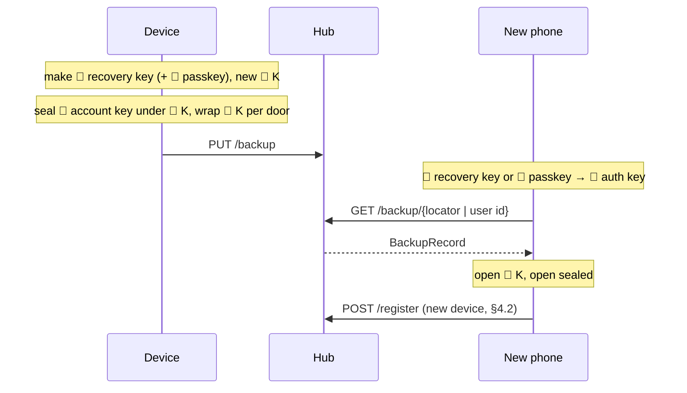

| Key | What | Kept |
|---|---|---|
| 🔑 `K` | 32 random bytes, new on every door change | memory only |
| 🔑 recovery key | libsignal `AccountEntropyPool`, 64 chars a–z 0–9 in blocks of 4; `BackupKey` = HKDF(pool, "20240801_SIGNAL_BACKUP_KEY") | the person, device keychain, inside `sealed` |
| 🔐 passkey | WebAuthn PRF, salt `SHA-256("yo backup v1")`; user handle = user id | password manager |
| 🔐 auth keys | Curve25519 (XEdDSA) from HKDF(PRF, "yo backup v3 auth passkey") or HKDF(BackupKey, "yo backup v3 auth code") | derived when needed |
```
struct { uint8 version = 3;
         opaque by_passkey<V>;     // 🔑 K under HKDF(PRF, "yo backup v3 passkey"); empty without
         opaque by_code<V>;        // 🔑 K under HKDF(BackupKey, "yo backup v3 code")
         opaque sealed<V>;         // under K: pad(account key, username, user id, recovery key) to 1/4/16/60 KiB
         opaque locator<V>;        // HKDF(BackupKey, "yo backup v3 locator"), 16 bytes; empty: by user id only
         opaque auth_passkey<V>;   // 32 bytes or empty
         opaque auth_code<V>; } BackupRecord;   // 32 bytes
```
- Wraps use HKDF-SHA256 (no salt, label as info) and ChaCha20-Poly1305 (nonce[12] ‖ ciphertext ‖ tag). Wrapped `K` is 60 bytes. `🔑 Recovery key` input ignores case, spaces and dashes.
- Each door binds to its original `🔑 recovery key` and `K`. Replacing the `🔑 recovery key` requires the `🔐 passkey` again for that door.
- The passkey's RP ID is fixed; a new RP ID loses the passkey door. Either door opens `sealed`, which holds the `🔑 recovery key`.
- Upload: the hub replaces the record and retires the old locator. The hub MUST reject (`400`) unless v3, wraps ≤ 256 B, `sealed` ≤ 60 KiB, canonical `🔐 auth keys` and nonempty `by_code`, `sealed`, `auth_code`. A locator equal to a user id or another account's locator → `409`.
- Fetch: the hub requires the door's signature; bad signature or no record → `404`; with `Yo-Nonce` it signs the `200` (§4.1). Only clients check wraps.
### 2.5 Linking a device
A signed-in device adds a new one by camera; no secret is ever shown, and nothing needs comparing because both devices are in front of the user.
1. The new device makes a one-time X25519 key `E` and calls `POST /v1/link` (anonymous). The hub answers a link id: ≥ 128 random bits, one use, 10 minutes. The device shows `yo-link:<link id>.<E public>` as a QR code.
2. The old device scans it. It MUST ask once ("This device gets access to your account") before it seals `LinkBundle { username, 🔐 account key, 🔑 storage key }` with HPKE to `E` (aad = link id) and stores it with `PUT /v1/link/{id}`. A scanned code MUST NOT link without that tap.
3. The new device waits with `GET /v1/link/{id}` (≤ 60 s), opens the bundle, registers with the current `🔐 account key` as an added device (§4.2) and loads the storage (§4.3).
   `LinkBundle { username; opaque account_secret[32]; opaque storage_key[32]; }`, HPKE as OHTTP (§4.1) with info "yo link bundle", sealed = enc ‖ ciphertext, ≤ 1 KiB. `PUT` is signed by the old device; `GET` answers `200` once, `204` when the wait ends, `404` expired or taken.
4. The hub sees only link id, time and ciphertext. It keeps links in memory only (≤ 10 000 open, else `503`). It MUST delete the bundle on fetch or expiry, MUST NOT log link ids and limits `/v1/link` per IP.

Without an old device, recovery (§2.4) remains. A device without a camera path (CLI) shows the `yo-link:` text to paste.

## 3. Session
### 3.1 Sessions
libsignal handles setup, ratchets, healing and reordering (PQXDH, Double Ratchet, Sesame, §5). Yo defines `🔐 prekeys`, addresses and session start. Each device pair has one session at `ProtocolAddress(ACI(user id), device number)`. Its identity must match the pinned `🔐 account key`. After first contact, use the pinned id and session.
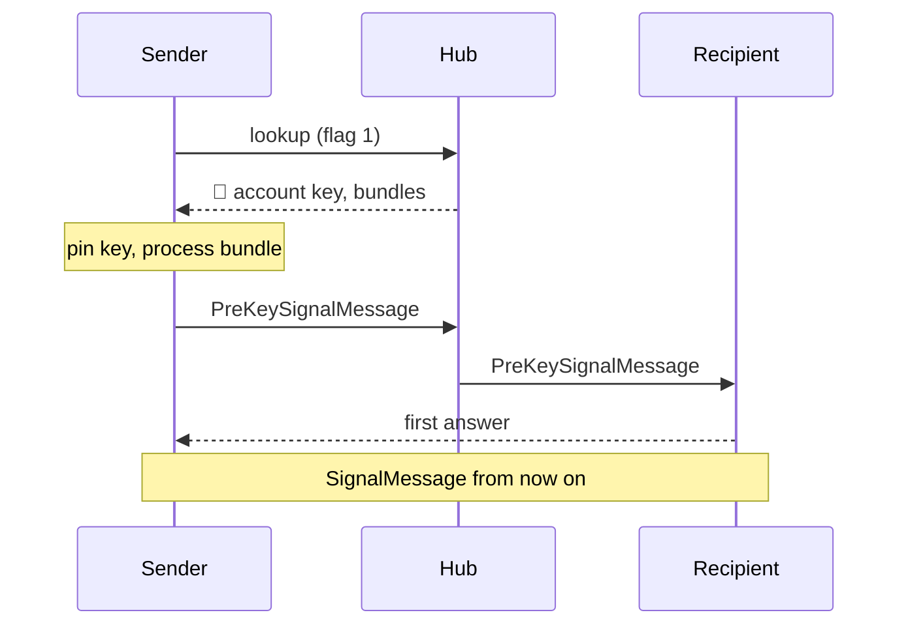
```
SignedPrekey { uint32 id; opaque key<V>; opaque signature<V>; }
Prekey { uint32 id; opaque key<V>; }
Prekeys { optional<SignedPrekey> signed, last_resort; Prekey one_time<V>; SignedPrekey kyber<V>; }
Bundle { opaque device_key[32]; uint32 registration_id; SignedPrekey signed, kyber; optional<Prekey> one_time; }
```
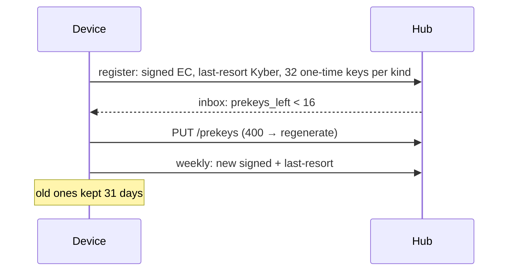
- The hub assigns the lowest free device number (1–127). A user has at most 16 devices with distinct keys and numbers. Both ends MUST bind both addresses into the MAC.
- Clients MUST choose a random nonzero 14-bit registration id and MUST increase `🔐 prekey` ids monotonically. They SHOULD rotate signed and last-resort keys weekly, refill below 16 one-time keys, keep replaced keys 31 days and keep the newest 128 private `🔐 one-time keys` per kind. Clients MUST reject a repeated base key on a last-resort Kyber prekey (≤ 20,000 markers).
- Without a bundle, senders SHOULD queue, report `Outdated` and retry at most hourly until the device opens a session. Clients MUST look up a typed username that is not a pinned contact; a typed name of a pinned contact resolves locally to its account, like picking it from the list. Clients SHOULD refresh pinned contacts on failure.
- Receivers MUST match content by the pinned `🔐 account key`, else look it up, and MUST drop unknown keys. First content raises `NewChat`.
### 3.2 Messages
The sender posts all device copies together. The hub accepts only a current roster. Acceptance is final. Clients keep a persistent outbox and an ordered inbox, so crashes lose nothing.
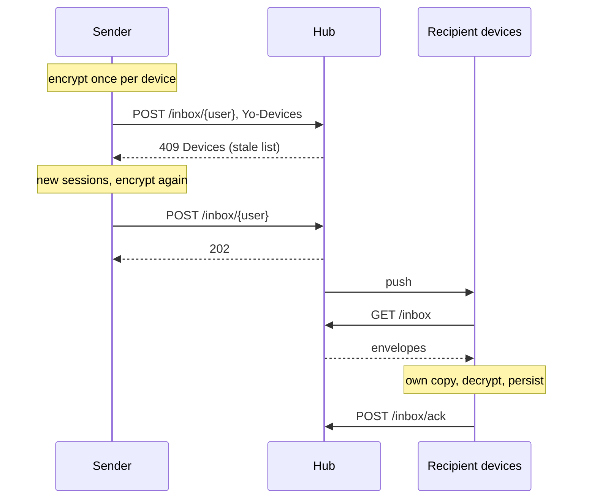
```
Plain { optional<UserId> to; opaque content<V>; }          // to: the recipient, on a sent transcript to own devices
ForDevice { opaque device_key[32]; uint8 kind; opaque message<V>; }   // kind 0 Signal, 1 PreKey, 2 Plaintext
Payload { opaque account_key[32], device_key[32]; uint8 device_id; uint64 sent_at; ForDevice copies<V>; }
Device { opaque key[32]; uint8 id; }
Devices { opaque account_key[32]; Device devices<V>; }
CopyFor { uint8 device; opaque envelope<V>; }
Copies { CopyFor copies<V>; }
devices_hash = SHA-256("yo devices v1" || account_key || sorted device keys)
```
- `sent_at` is in milliseconds and MUST increase strictly per sending device.
- `Yo-Copies: 1`: `Copies`, one bucket-sized envelope per device, ≤ 256 KiB total; without it one envelope for all. Missing copies skipped.
- The hub MUST validate device numbers, MUST store all supplied envelopes (subsets too) and MUST NOT reuse inbox ids. Inbox ids are opaque: clients MUST NOT assume they are dense or increase across fetches; a fetch returns every envelope not yet acked.
- Receivers SHOULD drop duplicates: the last 2000 plaintexts per sender device and the last 2000 opened hashes.
- Self-delivery MUST be identified and signed; the hub MUST reject sealed self-delivery. It excludes the sender and is never a request.

**Own devices.** Clients track their own list like a contact's and trust the first one. Siblings learn chats and groups from storage (§4.3).
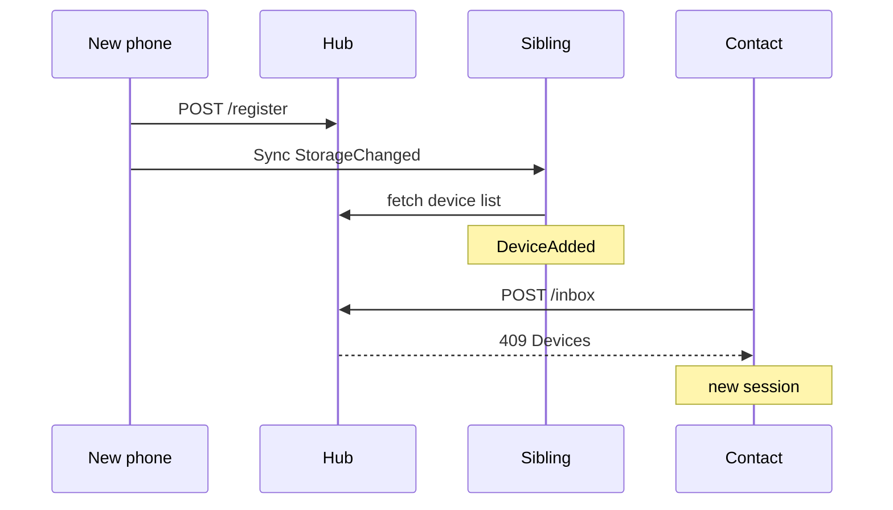
Clients SHOULD fetch the list after registration (a new account after one day) and daily, and MUST fetch it on `409` and on content from an unknown sibling. Only own devices raise `DeviceAdded`.

**Sent transcripts.** A 1:1 message also goes, with `to` set to the recipient, to every own device on the current signed list, except one the list dropped before (removed or replaced) that the hub lists again; a device listed after this one joined raises `DeviceAdded`. The receiving device shows it as sent and marks a known contact accepted; it MUST NOT create a contact for an unknown `to`. Groups have no transcripts. Clients SHOULD fetch bundles only for pending deliveries and MUST put self and usable sessions in `except`.

- **Outbox.** Clients MUST persist the advanced ratchet before posting. They SHOULD queue offline and encrypt at dispatch, SHOULD retry on network errors, `429`, `426`, `5xx` and `507`, and MUST drop on `400`, request `403`, `404` or `413`. A `404` marks the contact gone (`NotOnYo`).
- **Inbox.** Clients MUST persist before acknowledging; delivery is at least once. They SHOULD ack full batches of 100 before the next fetch and run acks, receipts, errors, `🔐 prekeys`, outbox and storage after the inbox read (`after_sync`). Parked envelopes MUST be retried in order; above 256 the oldest MAY be dropped.
- **Media.** A blob ack means stored, not viewed. Clients SHOULD delete file and key after viewing and SHOULD NOT resend a `Media` among the last 64 per recipient; new members still get theirs.

```
Content { uint16 version = 1; uint64 sent_at; uint16 type; opaque body<V>; }
With { uint16 kind; opaque data<V>; }
Media { opaque id[16], key[32], sha256[32]; uint32 size; uint16 width, height; }
GroupTag { opaque key[32]; uint32 revision; }
Read { optional<UserId> user; optional<GroupIdentifier> group; uint64 through_sent_at; }
```

| Type / kind | Body | Shown | Rule |
|---|---|---|---|
| 1 Yo | empty or `With with<V>` | yes | sorted, unique by kind |
| ↳ `With` 4 photo | `Media` | | ≤ 2048 px; wins over a later video |
| ↳ `With` 5 video | `Media media; uint32 duration_ms` | | ≤ 10 s, ≤ 9 MB, below `MAX_BLOB_LEN` |
| ↳ `With` 6 group | `GroupTag` | | §3.4 |
| ↳ `With` 7 `🔑 profile key` | `opaque key[32]; uint32 generation` | | §3.3 |
| 6 Receipt | empty | no | one per contact per sync |
| 8 Group | `GroupTag` | no | change notice (§3.4) |
| 10 ProfileKey | `opaque key[32]` | no | §3.3 |
| 11 Probe, 12 ProbeReply | `opaque token[32]` | no | PING; no events or state |
| 13 Sync | `uint8 kind`, body | no | own account only |
| 14 Connect | `uint8 kind; opaque code[32]` | no | services; matched by code |

- Sync kinds: 0 Read (`Read reads<V>`, 1–100; clears sibling notifications through `sent_at`) · 1 StorageChanged (§4.3) · unknown: skipped, kept.
- Connect kinds: 0 connect by link code · 1 end by fresh code · 2 connected · 3 refused · 4 ended · 5 decline without reply.
- Reserved: types 2, 3–5, 7; `With` 1–3. Receivers MUST reject an unknown version; unknown types and kinds follow §4.1.
- View-once media uses a fresh ChaCha20-Poly1305 key, zero nonce and empty AAD (§4.3); the blob holds only ciphertext. Receivers MUST check sizes against the decoded bytes. The app's list is not protocol (`app/core/product/src/list.rs`).

**Decryption errors.** The receiver asks the sender to start over. Senders resend only their own, still-held content (§5).
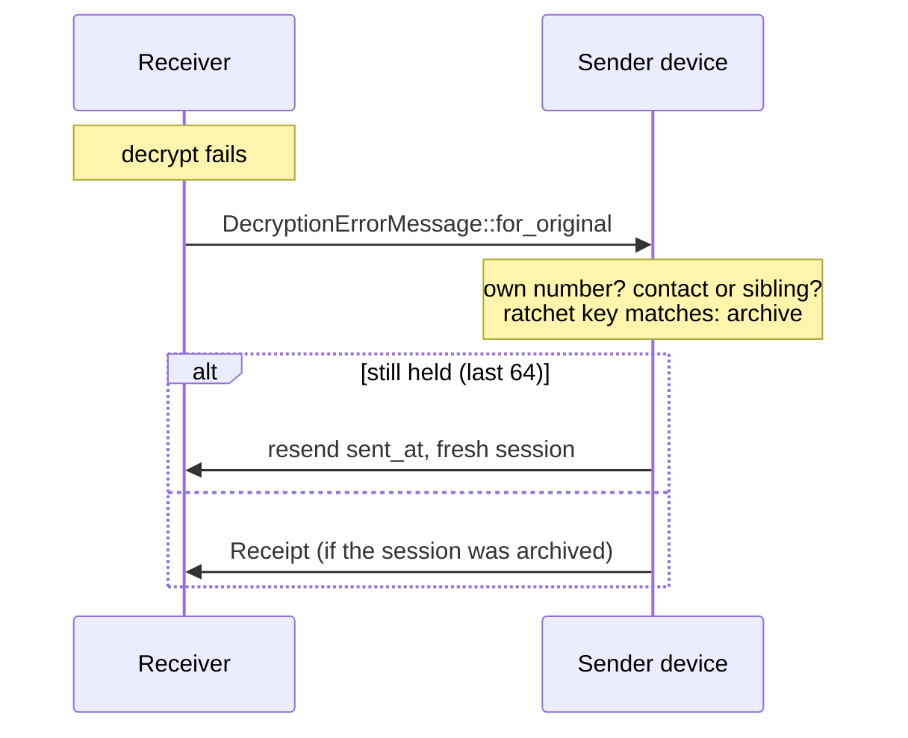
- Error: out-of-session `PlaintextContent` with ratchet key, `sent_at`, sender number. Clients SHOULD keep ≤ 64 pending per contact and for siblings.
- Before a sender's first decryption, receivers MAY look up its `🔐 account key` and check its roster ≤ 1/min/user, plus 10 recovery lookups/day (§4.1). They MUST discard unverified claims and MUST pin only after opening, or after an error if the roster confirms key and number.
- If another device holds the number, receivers MUST decrypt in a transaction and commit only after roster confirmation; they SHOULD park the envelope while the check is unavailable.
- Parked envelopes keep per-sender order: a parked sender's later envelopes wait behind it. A lookup refused by its limit parks and acks the envelope. An error from an unknown sibling is dropped.
- Senders MUST resend group content only while both are members and MUST NOT resend sync. Receivers MUST NOT treat an identified envelope alone as proof of its sender.
### 3.3 Contacts
Clients show, hold or block incoming content by contact state. The hub checks a profile-derived `🔑 access key` to filter strangers without learning contacts.
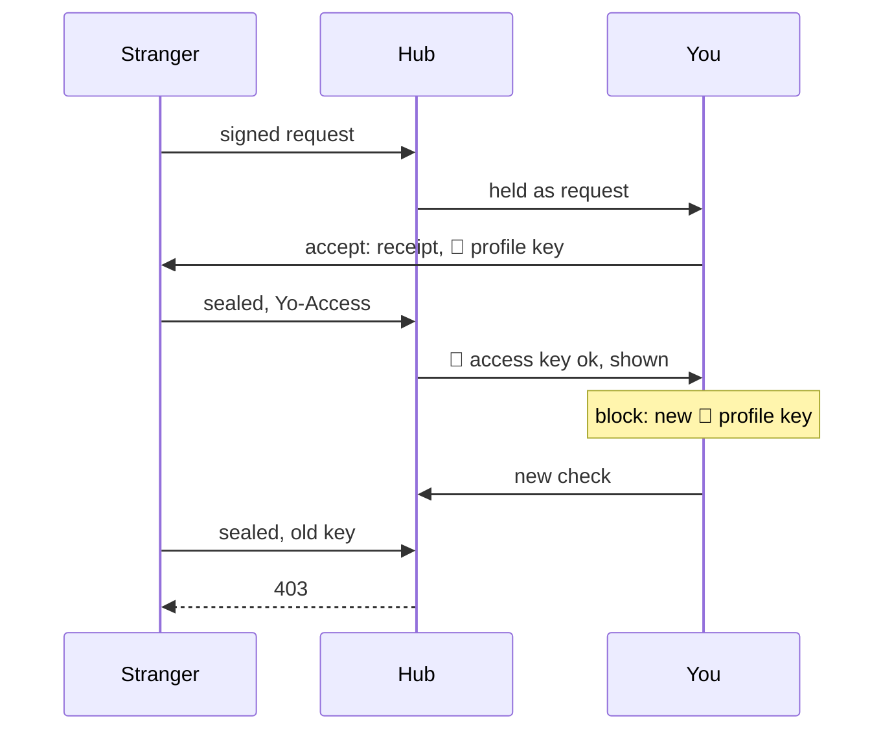

| State | When |
|---|---|
| contact | you sent, chatted via lookup, added, accepted or replied |
| removed | removal (`r`, §4.3), also after restore; adding or a Yo restores it |
| request | any other inbound content; no receipts, keys or errors go back (except to a sender with no opened message) |

**Hub admission.** The hub MUST accept contact deliveries with a matching `🔑 access key` or endorsement, signed requests under §4.1, and deliveries to legacy recipients without a check. It MUST reject other unsigned deliveries with `403`.

- **`🔑 Profile key`.** One zkgroup `ProfileKey` per account. Clients MUST attach it to every Yo to contacts and joined members (`With` 7) and MUST send type 10 before first content, on acceptance, rotation and unblock. Generations start at 1; receivers MUST ignore older ones and MUST accept type 10 even from blocked senders.
- **`🔑 Access key`.** Senders MUST put the 16 bytes from `derive_access_key` as base64url in `Yo-Access` (their own for siblings). Each client MUST publish `AccessKey { check[32], uint8 requests_open, commitment<V> }` signed. The hub MUST store only `SHA-256("yo access key" || access key)` and compare in constant time.
- **Identified contacts.** Clients SHOULD send them the current key first, at most hourly per key. On request `429` the sender MUST hold that recipient's envelopes until expiry or key arrival; the priority key MAY still go.
- **Blocking.** Blocks are local. Clients MUST publish the new check at once, MUST discard blocked messages unseen and MUST pause sends until unblock. With `ro` off (default on, §4.3) they MUST drop strangers and unjoined groups silently; the hub is unchanged.
- **Rejection.** On keyed `403` the sender MUST forget the key and keep the envelope, SHOULD read the inbox, and retries with a fresh key or as a request. A request on `403` MUST be dropped.
- **Restore.** Friends and keys come from storage; requests MUST NOT survive. Without an own key, clients MUST generate and send one as on block.
### 3.4 Groups
Groups are Signal's Groups v2: the hub stores only encrypted state, and members prove membership anonymously. Any member can add, remove or rename at the current revision. Yos go pairwise.
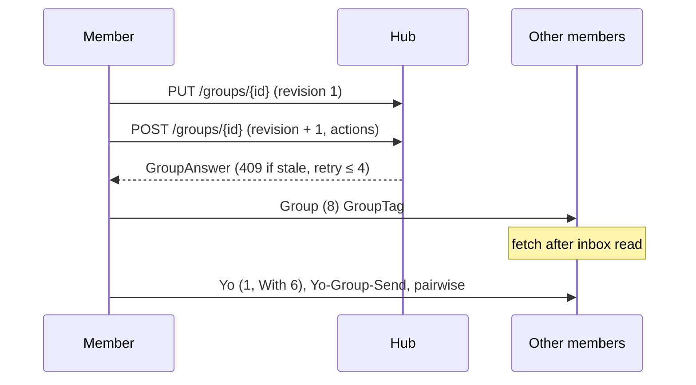

| Item | Contents |
|---|---|
| 🔑 `GroupMasterKey` | creator's 32 random bytes, shared by members; derives `GroupSecretParams` and the 32-byte `GroupIdentifier` |
| Hub parameters | the hub's `ServerPublicParams`, pinned by apps; no pins, no groups |
| Stored | `GroupPublicParams`, creation and change times, `GroupState { uint32 revision, title, GroupMember { user, profile_key, added_by } members<V> }` |
| Member | ACI `UuidCiphertext`, `ProfileKeyCiphertext` (empty for an invitee), encrypted inviter |

| Call | Request | Answer | Errors |
|---|---|---|---|
| `GET /group-auth` (signed, daily) | – | `GroupAuthCredential { redemption_s, credential }`, `AuthCredentialWithPniZkc`, user id as ACI and PNI | – |
| `POST /group-credential` | `ProfileCredentialRequest { user_id, request }` against the registered commitment (§3.3) | `ExpiringProfileKeyCredentialResponse`, 6–7 days | `404` no commitment, `403` wrong key |
| `PUT /groups/{id}` | `NewGroup { public_params, auth, title, NewMember { user, presentation } members<V> }` | `GroupAnswer` | `400` id or parameters, `409` id taken or ended |
| `POST /groups/{id}` | `GroupRequest { auth, revision, GroupAction { kind, data } actions<V> }`; no actions = fetch | `GroupAnswer` | `403` no member in the presentation, `409` stale, `404` ended |

- Actions: 1 add `NewMember` · 2 remove a ciphertext (self = leave) · 3 replace title · 4 present own `🔑 profile key`.
- The hub MUST require a zkgroup proof on every call except `group-auth` (signed calls are also accepted). The creator is a member. The last member out ends the group; ended ids MUST stay taken.
- Title: 1–32 bytes, padded to 32, sealed. Receivers MUST treat an invalid title as absent.
- Inviters SHOULD send an `ExpiringProfileKeyCredentialPresentation`, else the ciphertext. Invitees MUST join at once only if their entry has a key or the inviter is self or a contact; otherwise they see a request, accepted with action 4 or declined by leaving.
- Senders MUST seal with `Yo-Group-Send` (endorsed `GroupSendFullToken`, base64url); invitees and members without a `🔑 profile key` get a request (§3.3). Group sends create no direct chat. One blob serves all current members (§4.3).
- `GroupAnswer` returns endorsements for keyed entries in order, valid 25–49 h (zkgroup `default_expiration`). Clients SHOULD refresh with < 1 h left and MUST refresh after `403`.
- Receivers SHOULD hold ≤ 64 Yos for an unknown group or newer revision and fetch after the inbox read. They MUST accept a nonmember tag at most one revision ahead, MUST drop nonmember Yos and MUST skip undecryptable entries. `403` or `404` marks the group left. Clients SHOULD track ≤ 256 groups per device.
### 3.5 Services
Services are bots whose Yo account lives on our server. They are **not end-to-end** with the service: the executor holds the account and decrypts what you send it. A script decides the answer; it gets no keys, no network and not who you are.
```
Yo        phone ◄─encrypted─► hub ◄─► executor ◄─► script
Bridge    other service ──► api.justyo.app/NAME/… ──► entrance ──► executor ──► script
```
- The executor MUST keep per Yo only service, direction and time. It MAY keep the user id only while a reminder waits or for a connected user; a finished reminder's user stays readable 7 days, then only the count remains.
- Content MUST NOT be stored; the script answers and its input is discarded.
- Bridges: a connection stores only hashes of the call secret and the id the other side knows; connect requests expire after 600 s, OAuth codes after 300 s. For a connected user the executor keeps the last 50 items for the other side to fetch.
- Each service declares its names, triggers and allowed calls in its manifest (`yo-services`); anything else is refused.
## 4. Net
### 4.1 Transport
The hub is reached only over HTTPS (plain HTTP redirects, HSTS 6 months).

**Oblivious HTTP.** Clients that support it MUST wrap every request to the hub's `🔐 OHTTP key` (RFC 9458 with Binary HTTP, RFC 9292) and `POST` it to `/v1/ohttp`. Only key discovery and ticket transfers stay direct. A failing OHTTP path or pin MUST NOT fall back to direct requests. Yo uses OHTTP in a simplified form, without a separate relay: it hides from the TLS proxy what a request is (which inbox, which name, which account), not the IP from the hub. The proxy then sees only IP, time and size. The hub still sees the IP and uses it for rate limits (§1.1, §4.1 limits).
- **Suite.** DHKEM(X25519, HKDF-SHA256), HKDF-SHA256, AES-128-GCM. The key config is served at `/.well-known/yo-ohttp` (`application/ohttp-keys`); apps pin current and spare by app update, discovery never adds a pin.
- **Dispatch.** The hub serves only the YoIP routes of the endpoint table inside OHTTP (no admin, support, discovery, ticket or nested OHTTP), with their usual signatures and limits. An answer the client unwraps is authentic and fresh: only the holder of the pinned key can wrap it to that request, so OHTTP clients send no `Yo-Nonce` and take answers unsigned. Once unwrapped, every answer, errors included, goes back padded and wrapped in an outer `200`; only failures before unwrapping use outer errors; an unknown key id is an outer `422`, after which the client MAY retry once with its spare.
- **Replay.** Each request carries an inner `Date`; the hub MUST refuse dates off by more than 5 minutes and any `enc` it accepted within that window. Clients MUST NOT retry a wrapped request automatically unless they know it was not processed.
- **Padding.** Both directions MUST be padded with Binary HTTP zero padding to fixed buckets of the whole wrapped body: 1, 4, 8, 16, 64, 256 KiB, 1, 4, 16 MiB (`net/limits.rs`). A one-device Yo in a 736 B envelope fits the 1 KiB bucket. Blobs never take these buckets: they go by ticket outside OHTTP, as uploaded; the large buckets are for answers such as an inbox fetch.
- **Tickets.** Media does not go through OHTTP. Inside OHTTP the client asks for a ticket for one blob and one direction by sending the blob `PUT` (with `Yo-Blob-Length`, length and digest bound by the signed request) or `GET` (with the blob capability) with `Yo-Ticket: 1`; the answer body is the ticket, base64url; it is ≥ 128 random bits, works once and expires after 5 minutes. The transfer is `PUT` or `GET /v1/blobs/t/{ticket}`, direct, `Cache-Control: no-store`; the hub checks length and digest before keeping an upload. Logs MUST NOT keep tickets.
- **Connections.** The separate connections of §1.1 hold for OHTTP too: anonymous and signed requests use separate connection pools to the proxy that never coalesce, so connection reuse links nothing. IP, size and timing can still be correlated (§5.1).
- **App.** The outer `Yo-App` applies inside unless the inner request carries its own.
- **Round trip.** Clients MAY report how long the hub takes to answer them, so the operator sees the delay per region. They time requests they send anyway (sent to answer, no long polls or large bodies) and keep only the last bucket: `0` < 50 ms, `1` 50–100, `2` 100–200, `3` 200–400, `4` > 400. At most every 10 minutes, the next anonymous request carries it inside OHTTP as `Yo-Rtt: 0`–`4`; never a request of its own, never on signed requests, never an exact value or an id, and nothing about it is kept on the device. It is one of 5 values on a request that already shows its IP, so it links nothing. Only behind Cloudflare, the hub takes the continent of the proxy's data centre from `CF-Ray` (its suffix, the outer request's for OHTTP): `eu`, `am`, `as`, else `other`; requests without it are not counted. It adds 1 to an hourly count per continent and bucket (`rtt-eu-0` … `rtt-other-4`) and keeps nothing else.
- **Limits.** Before unwrapping, the hub MUST limit `/v1/ohttp` per IP (§4.1 limits) and by body size, taking the IP only from the proxy.
- **Rotation.** The hub holds the key in use; the spare stays offline until a rotation. A new key gets a new key id; the old one stays accepted for the config's cache lifetime. A compromised key is dropped at once. Retired private keys MUST be erased everywhere, backups included.
- **Migration.** Direct routes stay for older apps until at least 80 % of devices active over 30 days use OHTTP (§5.2); then only discovery, support, admin, `/v1/ohttp` and ticket transfers remain direct, and former direct YoIP routes answer `426` so older apps show their update notice. With them go signed answers and the `🔐 hub key`.

Contact deliveries use unsigned, padded, sealed envelopes. The hub sees inbox and size. Without a valid 24 h `🎟️ sender certificate`, send once identified and fetch one.
```
Padded { uint8 version = 1; uint32 length; opaque payload[length]; opaque zeros[...]; }
envelope = SealedSenderV1(UnidentifiedSenderMessageContent {
    type plaintext, SenderCertificate, contents = Padded(Payload) })
```
- Envelope: padded to 736 B, 1, 4, 16 or 64 KiB (736 B only once receivers accept it; senders keep 1 KiB until then); first byte sealed `0x11`, identified `1`; the hub MUST reject others with `400`. Identified fallback: signed `Padded`, `Yo-Access` if known.
- Certificates bind ACI, device number and `🔐 account key` under an offline Curve25519 root; apps pin current and spare roots. Clients SHOULD fetch one at registration and when < 2 h of 23 h remain, ≤ 1/min. Receivers MUST verify root, key, number and user at inbox `received_ms` and MUST drop on failure.

**Hub keys.** The hub holds these secrets, each for live and dev; apps pin the public halves marked as pinned. Losing a pinned key without its spare strands every app, so each lives offline in the operator's vault as well.

| Key | Kind | Pinned by apps | Used for |
|---|---|---|---|
| 🔐 Hub key (+ spare) | Curve25519 XEdDSA | yes, current and spare | signed answers (§4.1) |
| 🔐 Trust root (+ spare) | Curve25519, kept offline | yes, current and spare | signs the server certificate |
| 🎟️ Server signing key and its certificate | Curve25519, certificate signed by the trust root | no | signs 🎟️ sender certificates (§4.1) |
| 🔐 Mesh CA (+ one certificate per server) | Ed25519 X.509, root kept offline | no | mutual TLS between the operator's servers |
| 🔐 zkgroup `ServerSecretParams` | zkgroup | public params | group credentials and endorsements (§3.4) |
| 🔑 APNs key, FCM service account | provider credentials | no | push (§4.2) |
| 🔑 Play Integrity keys | Google-issued | no | attestation (§4.2) |
| 🔐 OHTTP key (+ spare) | X25519 HPKE | yes, current and spare | Oblivious HTTP (§4.1) |
| 🔑 Admin token | random | no | admin routes (not part of YoIP) |
| 🔑 Cloudflare tunnel token | provider credential | no | the tunnel in front of the hub |

**Signed requests.**
```
Yo-Device: base64url(device id)
Yo-Time: milliseconds since 1970
Yo-Signature: base64url(XEdDSA(🔐 auth key, SignedRequest))
SignedRequest { opaque label<V> = "yo request v1"; opaque method<V>, path<V>;
                uint64 time; opaque body_hash[32]; }
```
Clients MUST send each header once and MUST persist strictly increasing request times (reset if ≥ 1 min ahead). The hub MUST accept each signature once and only within 5 min, else `401 clock <hub ms>`; the client SHOULD correct its offset and re-sign once. Backup fetches use the `🔐 door key` and omit `Yo-Device` (§2.4).

**Signed answers.** The hub signs key-carrying answers over a client nonce to prevent swaps and replays. Apps pin current and spare `🔐 hub keys`. Unpinned clients omit the nonce.
```
request   Yo-Nonce: b64url(nonce[16])
answer    body || signature[64]
signed    "yo hub answer v1" || nonce || uint16 len(path) || path || SHA-256(request body) || body   // path without query
```
Pinned clients MUST send `Yo-Nonce` and reject unverified answers (`Protocol`). Signed answers cover lookup `200` (`🔐 account key`, devices, bundles, username), inbox delivery `409` (`Devices`) and backup fetch `200` (record, §2.4).

**Endpoints.** Bodies are TLS-encoded `application/octet-stream` (§1.3). Endpoints stay stable; additions are optional; new Yo data is a new `With` kind.
- Apps SHOULD send `Yo-App: PLATFORM/BUILD[ VERSION]` (platform 1–16 of a–z, build digits, version ≤ 32 of 0-9A-Za-z.+-); the hub keeps it per device and answers `426` below `YO_MIN_APP`.
- Receivers MUST drop unknown types (`Unsupported`), skip unknown `With` kinds, keep unknown storage fields, treat unknown inbox status as "later".

| Endpoint (prefix `/v1` except `/.well-known/…`) | Auth | Body | Answer | § |
|---|---|---|---|---|
| `PUT /access-key` | signed | `AccessKey` | `204` | §3.3 |
| `DELETE /account` | signed | – | `204` | §4.2 |
| `POST /attest` | signed | `Attest { platform, payload }` | `AttestResult { verdict }` | §4.2 |
| `GET /attest/challenge` | – or signed | – | `AttestChallenge { challenge }`, or empty `204` when off | §4.2 |
| `PUT /backup` | signed | `Backup` | `204` | §2.4 |
| `GET /backup/{user id or locator}` | `🔐 door key` | – | record, else `404` | §2.4 |
| `PUT /blobs/{id}?fetches=n` | signed by body hash | ciphertext | `201` | §4.3 |
| `GET /blobs/{id}` | none | – | ciphertext, consumes no fetch | §4.3 |
| `DELETE /blobs/{id}` | none | – | `204`, consumes one fetch | §4.3 |
| `GET /devices` | signed | – | `OwnDevices { OwnDevice { number, created_at, last_seen_at, app } devices<V> }` | §4.2 |
| `DELETE /devices/{n}` | signed | – | `204`; own device `400`; unknown `404`; the removed device gets `410` | §4.2 |
| `POST /link` | – | – | link id (text), 10 min | §2.5 |
| `PUT /link/{id}` | signed | sealed `LinkBundle` | `204`; `404`; `409` already there | §2.5 |
| `GET /link/{id}?wait=s` | – | – | `200` bundle once; `204`; `404` | §2.5 |
| `PUT /bot` | signed | 1 (one byte, shown in lookups) | `204`; 0 on a bot `409`; other body `400` | §2.1 |
| `GET /certificate` | signed | – | libsignal `SenderCertificate` | §4.1 |
| `GET /group-auth` | signed | – | `GroupAuthCredential` | §3.4 |
| `POST /group-credential` | none (signed accepted) | `ProfileCredentialRequest` | `ExpiringProfileKeyCredentialResponse`; `404`, `403` | §3.4 |
| `PUT /groups/{id}` | zkgroup proof (signed accepted) | `NewGroup` | `GroupAnswer`; `409`, `403`, `404` | §3.4 |
| `POST /groups/{id}` | zkgroup proof (signed accepted) | `GroupRequest` | `GroupAnswer`; `409` (+ `GroupAnswer`), `403`, `404` | §3.4 |
| `GET /inbox?wait=s` | signed | – | `Inbox { prekeys_left, items { id, received_ms, envelope } }`, oldest first | §4.1 |
| `POST /inbox/ack` | signed | `Ack { ids }` | `204` | §3.2 |
| `POST /inbox/{user_id}` | none, or signed | `Copies` or one envelope | `202`; `409` + `Devices`; `403` | §3.2 |
| `POST /lookup` | signed | `Lookup { handle, flags, except }` | `LookupNamed`, `LookupResult` or `LookupBot` | §3.1 |
| `PUT /prekeys` | signed | `Prekeys` | `204` | §3.1 |
| `PUT /push` | signed | `Push` | `204` | §4.2 |
| `POST /register` | proof | `Register` | `Registered { user_id, optional<username>, uint8 device_id }` | §4.2 |
| `GET /storage` | signed | – | `Storage { version, data }`; `404` before the first write | §4.3 |
| `PUT /storage` | signed | `Storage` | `204`; `409` + current `Storage` | §4.3 |
| `GET /username/{name}` | – | – | `204` free, `409` taken or reserved, `400` no username | §2.2 |
| `PUT /username` | signed | `SetUsername` | `204` | §2.2 |
| `GET /.well-known/yo-hub-key` | – | – | hub public key, 32 bytes | §4.1 |
| `GET /.well-known/yo-trust-root` | – | – | `🔐 trust root` public key, 32 bytes | §4.1 |
| `GET /.well-known/yo-zk-params` | – | – | hub `ServerPublicParams` | §3.4 |
```
LookupResult  { user_id, account_key, Device devices<V>, bundles }
LookupNamed   { LookupResult, optional<opaque> username<V> }
LookupBot     { LookupNamed, uint8 bot }
opaque UserId[16]; opaque DeviceId[16];                  // hub ids, random
struct { uint8 kind; opaque value<V>; } Handle;          // 0 user id, 2 username (UTF-8), 3 account key
struct { uint8 platform; opaque token<V>; } Push;        // 0 none, 1 APNs, 2 APNs sandbox, 3 FCM
```
- Other bodies: `net/api.rs`. The `/v1/help/*` support and crash endpoints are not part of YoIP. Lookup flags: 1 bundles, 2 `LookupNamed`, 2+4 `LookupBot`.
- Inbox delivery: unsigned, or signed (request, identified, own user); headers `Yo-Copies`, `Yo-Devices`, `Yo-Access` or `Yo-Group-Send`.

Status: `404` unknown · `409` devices changed or name/locator/blob id taken · `410` device replaced or account gone · `429` limit named in the body · `507` no room.

**Limits.** The hub keeps in-memory rates that refill evenly; fetching is never capped. IPv6 counts per /64; behind Cloudflare the IP is `CF-Connecting-IP`. The hub MUST be reachable only through the proxy (an outbound tunnel, nothing inbound), else that header is forgeable. Loopback, operator bots and own services are exempt.

| Limit | Default | Over it |
|---|---|---|
| expensive, per IP | 10/h: registrations + failed backup fetches (`YO_EXPENSIVE_PER_IP_HOUR`) | `429` |
| deliveries, per IP | 1000/min and 64 MiB/h, every inbox delivery | `429 ip`, `429 bytes` |
| signed, per device | 1200/min, every signed request | `429 device` |
| `🔐 prekeys`, per device | 50/day, lookups handing out `🔐 prekeys` | `429` |
| lookups, per device | 1000/day, identity lookups | `429` |
| OHTTP, per IP | 3000/min, body 1 MiB | `429 ip`, `413` |
| name checks, per IP | 60/min | `429` |
| storage, per user | 120 writes/h | `429` |
| blobs, per IP | 120 PUT/min, 600 GET + DELETE/min | `429` |
| groups | 100 new/user/day, 200/IP/day; 120 anonymous calls/IP/min; 2000 credentials/IP/h | `429` |
| inbox, per recipient | 5000 waiting per device; 50 MiB burst + 50 MiB/h (`YO_RECIPIENT_BYTES_*`) | `507`; `429 recipient` |
| request, sender → recipient | 10, +1/h | `429 pair 3600` |
| request, new recipients per sender | 20, +1/h | `429 new` |
| request, to one recipient | 1000, +1000/day | `429 recipient` |
| body | 65 KiB, delivery 257 KiB (+1 KiB → `413` at once); blob 10 MiB; within 20 s, request 60 s | `413`, `408` |
| bodies in flight | 512, 64 per IP (blobs excluded) | `503` |
| `🔐 prekeys` | 2 KiB each, 32 one-time per kind per upload, 64 kept | `400`; `413` over 32 |
| inbox | 100 per fetch, wait ≤ 60 s, 1000 ids per ack, 4 fetches per device; kept 30 days | `413` over 1000 ids |
| push token / storage | 512 B / 60 KiB | `400` / `413` |
| blob | 1–64 fetches (320 with added devices), GETs fetches + 3, ≤ 30 days | `400` bad count; `404` used up |
| blobs per user | 2000 and 2 GiB/day, 1 GiB waiting, 4 uploads (256 total) | `429` |
| group | 20 accounts, title ≤ 256 B sealed | `400` |
| disk | < 1 GiB free: deliveries and new groups | `507` |

Request refusals carry `Retry-After` and hold only that recipient. Successful backup fetches are free. On `429` clients SHOULD pause work sharing the limit for the stated seconds (default 5 s, lookup 60 s) and retry envelopes in 1–30 s. A full queue returns `503`.
### 4.2 Accounts
Registration proofs carry no timestamp. Device ids are single-use forever.
```
Register { username; optional<Attest> attest; NewDevice { device_id, device_key, certificate, auth_key, push, registration_id, prekeys, proof } }
proof = XEdDSA(account key, "yo register v1" || Handle(username) || device id || device key || auth key)
```
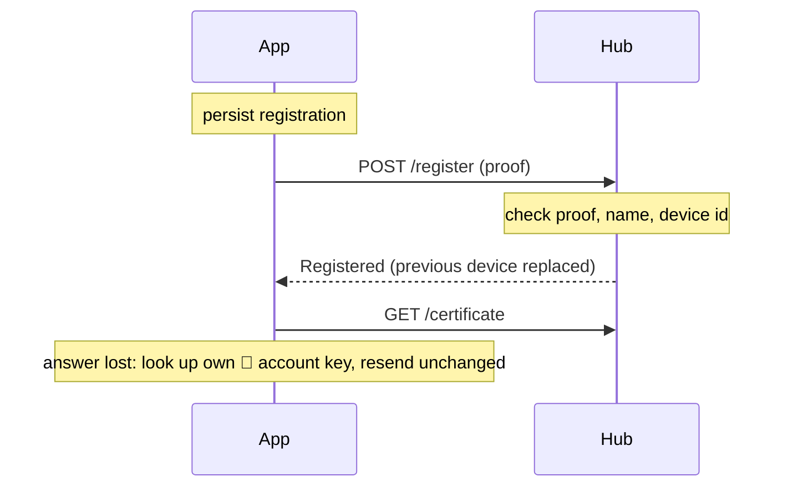
- Current `🔐 account key`: the hub re-registers under the current name and replaces the previous device. A hub with `YO_ADD_DEVICES=1` keeps it and MUST return `409` with body "device_limit" ‖ `OwnDevices` at 16; `RegisterReplacing { username; optional<Attest> attest; NewDevice device; uint8 replace }` first retires device `replace` (it then gets `410`).
- Another key: the hub creates a user if the name is free; a taken name or a replay MUST get `409` and replace nobody.
- Signed and last-resort `🔐 prekeys` are REQUIRED. The hub rejects (`400`) a registration id outside 1–16383 or a non-canonical Curve25519 `🔐 auth key`.
- Clients MUST persist registration before sending and MUST NOT generate a new key on resend. Account deletion MUST remove everything at once.

**Hub `🔐 prekeys`.** The hub stores keys as uploaded; receivers verify signatures (§3.1).
- An upload MUST replace the signed and `🔐 last-resort keys` it carries (others stay) and append `🔐 one-time keys` above the highest id (§4.1).
- The hub MUST return one bundle per device outside `except`, MUST hand out each `🔐 one-time key` only once, then the last-resort key, and MUST omit a bundle without signed or `🔐 last-resort key`.

**Device attestation.** Optional, off by default. Clients fetch the challenge, then post the payload (1 App Attest, 2 Play Integrity). Before registering, clients SHOULD fetch the challenge unsigned and send the payload in `Register` with the challenge in `Yo-Attest-Challenge`; it binds the challenge, not the account. A name check carrying an open challenge gets `Yo-Name-Min` 4 while that challenge is unanswered. The hub MUST NOT let attestation affect access, limits or delivery, except the name minimum (§2.2). Devices that cannot attest (no Google services, F-Droid, CLI, bots) get 12.

**Push.** A push wakes the device to fetch; it carries no content. The hub learns only urgency. Clients set the token with `PUT /v1/push`.
- `yo-urgent: true|false` defaults to true; the hub MUST reject other values with `400`. Senders SHOULD mark Yo, photo and video urgent. Apps SHOULD show only urgent deliveries.
- The hub SHOULD pace pushes at 1/s for contacts and 1/10 s for requests, and 1/10 min above 50 unacked.
- The hub SHOULD send urgent pushes as APNs mutable-content alerts at priority 10, others as background at priority 5; FCM data-only HIGH/NORMAL.
- Hubs that take deliveries in several places and sync them in the background MUST answer a short fetch (no `wait`) with what all of them hold for the device, asking the others within a short timeout (300 ms); one that does not answer is left out. A long poll does not ask them: an envelope that arrives wakes it. An ack at one hub removes the envelopes from all, also those not yet synced to it. A push stays a bare wake-up.
- With `split=1` on a short fetch such a hub answers `206` at once with what it holds itself; the client then sends `split=2` at once, which the hub answers `200` when the others have answered or timed out, with only what they added. Without the parameter clients get one answer.
### 4.3 Storage
**Blobs.** The 128-bit id inside the encrypted Yo grants access to the media ciphertext. The sender allots one fetch per recipient device.
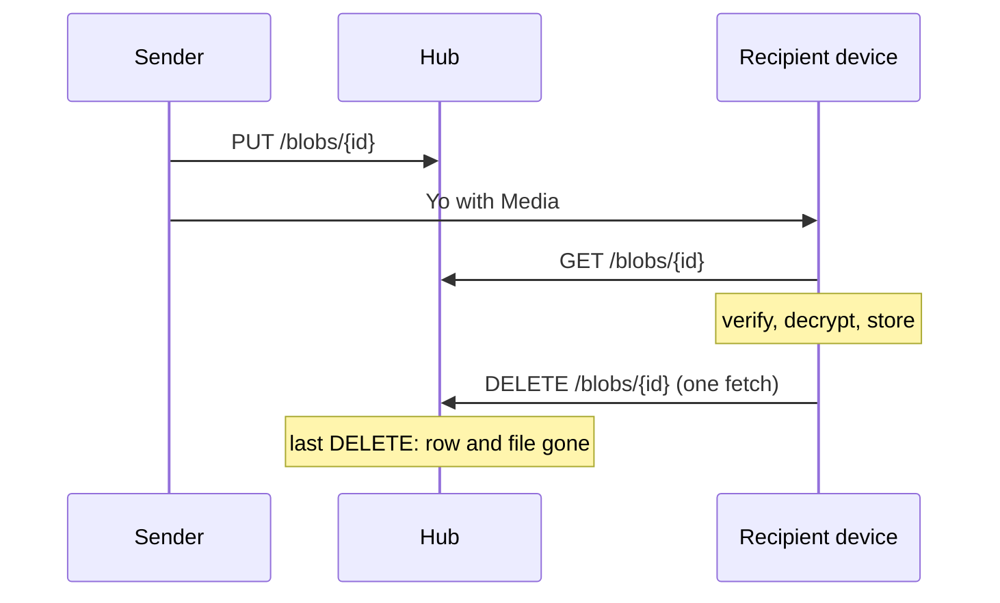
- The hub MUST check the signed base64url `Yo-Body-SHA256` and `Content-Length` before keeping an upload (§4.1).
- Answers: 201 stored · 409 id taken (after that upload completes) · 503 same id in progress · 400 < 16 bytes · 411 no length · 408 > 5 min · 413 > 10 MiB · 429 quota · 507 no room; retry later on `429`/`503`/`507`.
- The hub MUST persist the GET budget (§4.1), reserved at start and refunded on cut-off; exhausted → `404`. `DELETE` MUST still work and return `204`, also for unknown or expired ids.
- The hub MUST delete an uploader's blobs with the account; others expire per §4.1.
- Receivers MUST verify size and hash before storing, SHOULD persist the ack intent and write atomically, and SHOULD retry on later wakes.

**Storage.** The hub versions one encrypted record per account. Settings, contacts and groups converge across devices.
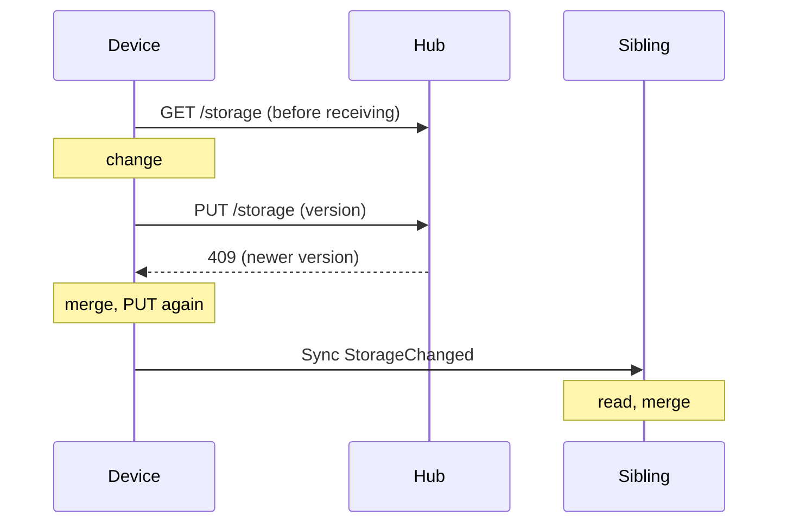
```
key  = HKDF(private part of the 🔐 account key, "yo storage v1")
data = nonce[12] || ChaCha20-Poly1305(key, nonce, pad(JSON), aad = "yo storage v1" || user id)
       // pad to 1, 4, 16 or 60 KiB minus 28 bytes so encrypted data fills the bucket
JSON = { "version": n,
         "friends": { "<user id>": { "n": name, "c": colour, "b": blocked, "r": removed } },
         "ro": requests from strangers,
         "pk": own 🔑 profile key, "k": { "<user id>": their 🔑 profile key | null once forgotten },   // base64url
         "g": { "<group id>": { "k": 🔑 master key (base64url, plain), "a": joined, "r": left } } }
       // every field is [value, ms when set]; other fields are the app's, kept as unknown fields (§4.1)
```
- `PUT` MUST carry the current version. On `409` clients SHOULD merge the returned record and retry ≤ 4 times per call, then SHOULD send `Sync` StorageChanged (§3.2). Receivers SHOULD merge after the inbox read.
- Clients MUST merge objects field by field and friends by union; per `[value, ms]` the newest wins, ties go to the bytewise larger JSON. Clients MUST set the own `🔑 profile key`'s time past the stored one.
- Readers MUST ignore a different version or a record that fails to open. They MUST accept unpadded JSON (first byte ≠ 1). Writers MUST pad storage and backups.
- Groups are kept as in Signal's `GroupV2Record` with `🔑 master key` and restored on first sync. Clients MUST mark left groups `r`, also when the hub denies membership. `ro` is absent until first set, then shared by all devices (§3.3).
- Names MUST be ≤ 64 bytes. Above 60 KiB writers SHOULD shed entries and MUST keep all blocked ones.

## 5. Considerations
### 5.1 Known limits
- Trust the hub for user, key and device bindings (§2.1) and the current backup (§2.4). Only the hub itself can serve an older backup (signed answers stop it in transit); a replaced `🔑 recovery key` opens it until the hub drops the old record. Signed answers prevent swaps and replays in transit. The hub itself can lie (§4.1).
- Comfort: the platform keychain (iCloud Keychain, Google Block Store) restores the `🔐 account key`, so whoever controls that cloud account can restore the account. Push urgency and opt-out crash reports are similar trade-offs.
- Strangers cannot lock out contacts. No rate limit applies solely by recipient across both delivery classes (§4.1). Forged decryption errors can only repeat content (§3.2).
### 5.2 Planned
- Accounts and groups: additional devices (phase 2), username changes or releases, group admins and invite links.
- Backup v4: bind version, door and user id as AAD, and commit to `K`.
- Oblivious HTTP (§4.1) for every client; the direct endpoints end at 80 % adoption (#8).
- Privacy: cover traffic, key transparency and private contact discovery.
- Abuse: attestation at registration if accounts are made in bulk.
### 5.3 References
- M. Marlinspike, T. Perrin, "The X3DH Key Agreement Protocol", Signal, 2016.
- E. Kret, R. Schmidt, "The PQXDH Key Agreement Protocol", Signal, 2023.
- T. Perrin, M. Marlinspike, "The Double Ratchet Algorithm", Signal, 2016.
- M. Marlinspike, T. Perrin, "The Sesame Algorithm: Session Management for Asynchronous Message Encryption", Signal, 2017.
- T. Perrin, "The XEdDSA and VXEdDSA Signature Schemes", Signal, 2016.
- Encoding and terminology: RFC 2119 and 8174 (key words), RFC 8446 §3 (presentation language), RFC 9000 §16 (variable-length integers).
- Cryptography: RFC 5869 (HKDF), RFC 8439 (ChaCha20-Poly1305).
- Unicode: UTS #51 (emoji), UAX #15 (normalization).
